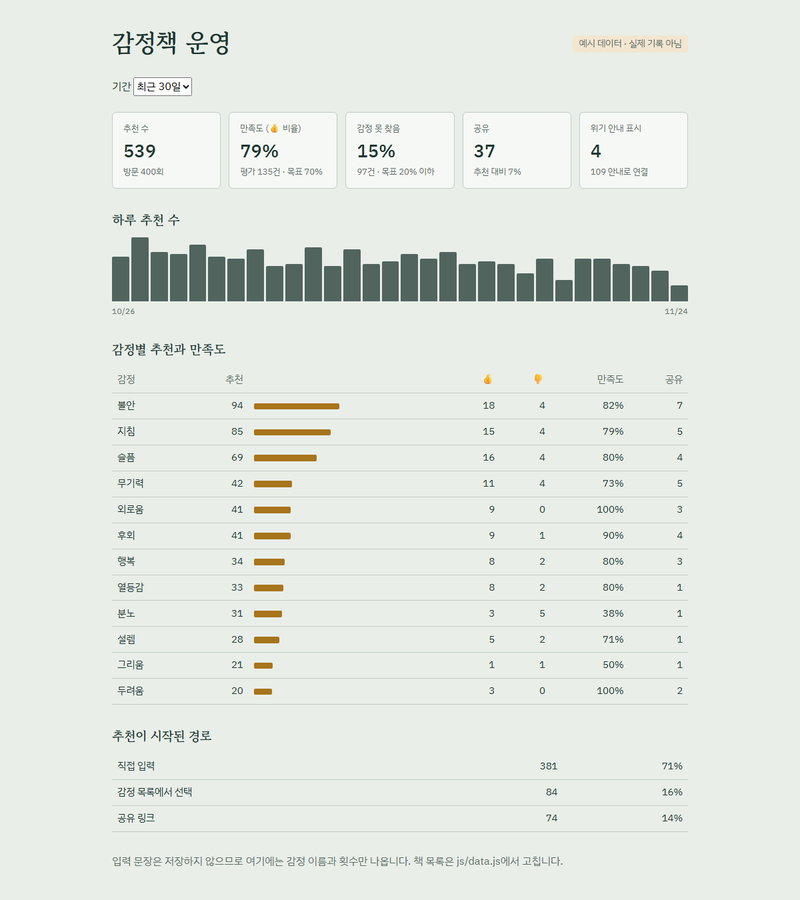

# 감정책 · emotionbook

**오늘 기분, 한 문장이면 책 3권.**
요즘 기분을 한 문장으로 적으면 감정을 읽고, 그 마음에 맞는 책 3권과 추천 이유를 보여 주는 웹 서비스입니다.

👉 **서비스:** https://ttottibabo.github.io/emotionbook/

| 첫 화면 | 추천 결과 (모바일) | 운영자 화면 |
|---|---|---|
|  |  |  |

## 주요 기능
- **감정 인식:** 12가지 감정 단어 사전으로 문장 속 감정을 찾습니다.
- **책 추천:** 감정마다 고른 책 3권과 추천 이유를 보여 줍니다.
- **안전 장치:** 자해·자살 표현이 있으면 추천 대신 자살예방 상담전화 109를 먼저 안내합니다.
- **피드백·공유:** 👍/👎로 평가하고, 감정 이름만 담긴 링크로 친구에게 공유합니다.
- **운영자 화면:** 추천 수, 만족도, 감정 못 찾음 비율, 공유, 위기 안내 수를 확인합니다.
- **개인정보:** 입력한 문장은 저장하지 않습니다. 감정 이름과 횟수만 익명으로 셉니다.

## 프로젝트 진행 과정
| 단계 | 결과물 |
|---|---|
| 1. 프로토타입 | [`prototype.html`](prototype.html): 규칙 방식과 AI 방식을 같은 문장으로 비교 (v4) |
| 2. 기획 | [`docs/PRD.md`](docs/PRD.md): 문제, 타깃, 범위, 지표, **마케팅·운영 계획** |
| 3. 구현 | `index.html`, `admin.html`, `styles.css`, `js/`, `firestore.rules` |
| 4. 테스트 | [`docs/TEST_REPORT.md`](docs/TEST_REPORT.md): 로직 35개, 화면 10개 통과 |
| 5. 배포 | GitHub Pages, `dist/` (Firebase Hosting용) |
| 기록 | [의사결정](docs/DECISION_LOG.md) · [성공/실패](docs/SUCCESS_FAILURE_LOG.md) · [작업 일지](docs/WORKLOG.md) · [에이전트 가이드](docs/AGENT_GUIDE.md) |

## 폴더 구조
```
emotionbook/
├─ index.html          사용자 화면
├─ admin.html          운영자 화면 (?demo=1: 예시 데이터)
├─ prototype.html      프로토타입 v4 (보존)
├─ styles.css          공통 스타일
├─ js/
│  ├─ data.js          감정 사전, 책 36권, 위기 표현
│  ├─ recommend.js     감정 인식 (순수 함수)
│  ├─ app.js           사용자 화면 동작
│  ├─ store.js         익명 기록·피드백 저장
│  ├─ admin.js         운영 지표 집계와 화면
│  └─ firebase-config.js  Firebase 설정 (비어 있으면 기록 생략)
├─ firestore.rules     데이터 접근 규칙
├─ firebase.json       Firebase 배포 설정
├─ build.ps1           dist/ 만들기
├─ dist/               배포 패키지
├─ tests/              로직·화면 테스트
└─ docs/               기획·기록 문서, 스크린샷
```

## 실행
- **그냥 보기:** 서비스 주소를 열거나 `index.html`을 브라우저로 엽니다. 로컬 파일로 열 때 모듈이 막히면 VS Code Live Server 같은 로컬 서버로 엽니다.
- **배포 패키지 만들기:** `powershell -ExecutionPolicy Bypass -File build.ps1`
- **테스트:** `tests/run.html`, `tests/ui.html`을 브라우저로 엽니다.

## Firebase 연결 (운영 기록 켜기)
1. [Firebase 콘솔](https://console.firebase.google.com)에서 프로젝트를 만들고 웹 앱을 추가합니다.
2. 설정값을 `js/firebase-config.js`에 붙여 넣습니다.
3. Firestore Database를 만들고, `firestore.rules` 내용을 규칙 탭에 붙여 넣어 게시합니다.
4. Authentication에서 이메일/비밀번호 로그인을 켜고 운영자 계정을 만듭니다.
5. Firestore에 `admins` 컬렉션을 만들고, 문서 ID를 운영자 계정의 UID로 추가합니다.
6. `admin.html`에서 로그인해 지표를 확인합니다.

연결하지 않아도 추천 기능은 그대로 동작합니다.

## 기술
HTML · CSS · JavaScript (ES 모듈, 빌드 도구 없음) · Firebase Firestore · Firebase Authentication · GitHub Pages
