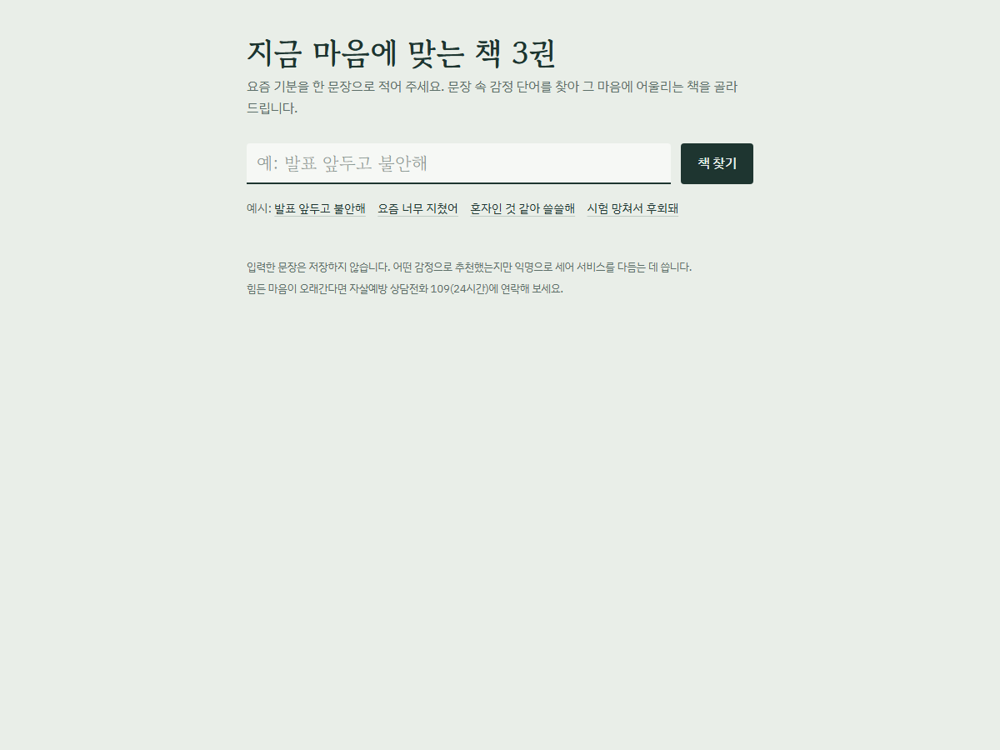
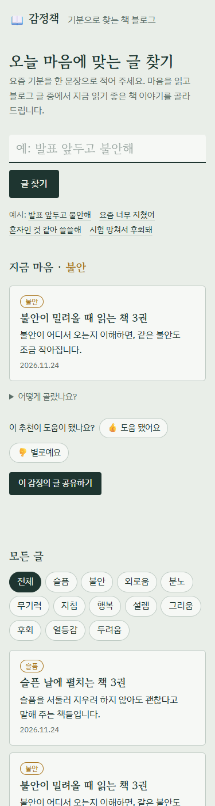
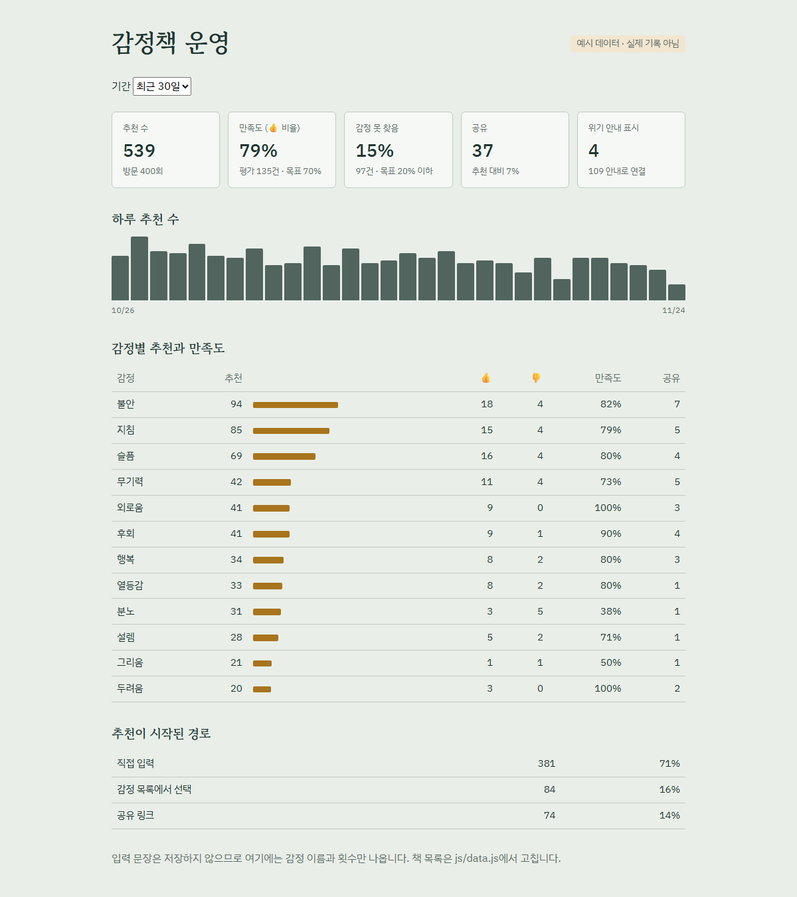

# PRD (Product Requirement Document) · 감정책 emotionbook

## 1. 기본 정보

| 항목 | 내용 |
|---|---|
| 문서 버전 | v1.0 |
| 작성일 | 2026-11-24 |
| 작성자 | ttottibabo |
| 서비스 URL | https://ttottibabo.github.io/emotionbook/ |
| 관련 문서 | [DECISION_LOG](DECISION_LOG.md) · [TEST_REPORT](TEST_REPORT.md) · [WORKLOG](WORKLOG.md) · [SUCCESS_FAILURE_LOG](SUCCESS_FAILURE_LOG.md) · [프로토타입 v4](../prototype.html) |

---

## 2. 개요

> **"오늘 기분, 한 문장이면 책 3권."**

- **배경:** 마음이 힘들거나 들뜰 때 책에서 위로나 공감을 얻고 싶어 하는 사람은 많습니다. 하지만 서점과 도서 앱은 베스트셀러, 장르, 신간 기준으로 정리되어 있어 **"지금 내 기분"을 기준으로 책을 찾기 어렵습니다.**
- **문제:** 감정이 지친 상태에서 수많은 목록을 비교하며 책을 고르는 일 자체가 부담입니다. 그래서 결국 아무것도 고르지 못하고 앱을 닫게 됩니다.
- **솔루션:** 요즘 기분을 한 문장으로 적으면 12가지 감정 중 하나로 읽고, 그 감정에 맞춰 미리 골라 둔 **책 3권과 추천 이유**를 10초 안에 보여 주는 웹 서비스입니다. 가입이 필요 없고, 입력한 문장은 저장하지 않습니다. 자해·자살 표현이 감지되면 추천 대신 **자살예방 상담전화 109**를 먼저 안내합니다.

---

## 3. 문제

### 3.1 데스크리서치

#### 3.1.1 SWOT 분석

| | 긍정 요인 | 부정 요인 |
|---|---|---|
| **내부** | **S (강점)** · 가입 없이 한 문장으로 10초 안에 결과 · 추천 근거("어떤 단어를 보고 골랐는지")를 화면에 공개 · 문장을 저장하지 않는 개인정보 보호 설계 · 위기 표현 안전장치 내장 · 서버 비용이 거의 없는 구조 | **W (약점)** · 규칙 기반이라 부정문, 상황 묘사 문장을 잘 읽지 못함 · 책이 36권(감정당 3권)으로 적음 · 1인 개발이라 콘텐츠 갱신 속도가 느림 · 브랜드 인지도 없음 |
| **외부** | **O (기회)** · 20~30대의 마음 건강·자기 돌봄 관심 증가 · 인스타그램 북스타그램, 책 큐레이션 콘텐츠의 인기 · 시험·취업 시즌처럼 감정이 몰리는 시기가 매년 반복됨 · 감정 기록·무드 트래커 앱 사용 습관 | **T (위협)** · 범용 AI 챗봇에 "불안할 때 읽을 책"을 직접 물어볼 수 있음 · 대형 서점·전자책 구독 서비스의 큐레이션 기능 · 정신 건강 관련 표현에 대한 책임 문제 |

#### 3.1.2 3C 분석

| 구분 | 분석 |
|---|---|
| **Customer (고객)** | 시험, 취업, 첫 직장처럼 감정 기복이 큰 시기의 20~30대. 책으로 위로받고 싶지만 고르는 데 시간과 에너지를 쓰고 싶지 않다. 인스타그램, 대학 커뮤니티, 오픈채팅에서 정보를 얻는다. |
| **Competitor (경쟁)** | ① **대형 서점·도서 앱 큐레이션:** 주제별 기획전이 있지만 감정이 아닌 판매 중심 분류이고, 찾아 들어가야 한다. ② **전자책 구독 서비스:** 구독 중인 책 안에서만 추천한다. ③ **범용 AI 챗봇:** 자유롭게 물을 수 있지만 매번 질문을 잘 써야 하고, 없는 책을 만들어 내는 경우가 있다. ④ **북스타그램 큐레이션 계정:** 감성은 좋지만 지금 내 상황에 맞춘 추천은 아니다. |
| **Company (자사)** | 작동하는 프로토타입(v4)과 규칙 vs AI 비교 경험이 있다. 웹 개발과 배포를 직접 할 수 있고 운영 비용이 거의 없다. 마케팅 예산은 없으므로 콘텐츠와 공유 중심으로 성장해야 한다. |

> 경쟁 서비스의 시장 규모·사용자 수 같은 수치는 출처를 확인해 추가 예정입니다.

### 3.2 문제 발굴

#### 3.2.1 문제 목록

| # | 문제 | 타깃 | 솔루션 아이디어 |
|---|---|---|---|
| P1 | 지금 기분에 맞는 책을 찾을 방법이 없다 | 책으로 위로받고 싶은 20~30대 | 감정 → 책 추천 |
| P2 | 책을 고르는 과정이 피곤해서 포기한다 | 지친 직장인·수험생 | 3권만, 이유와 함께 바로 제시 |
| P3 | 내 속마음을 앱에 적는 것이 꺼려진다 | 개인정보에 민감한 사용자 | 문장 미저장, 가입 없음 |
| P4 | 추천을 왜 받았는지 몰라 믿음이 안 간다 | AI·알고리즘 추천에 피로한 사용자 | 추천 근거 공개 ("어떻게 골랐나요?") |
| P5 | 힘든 순간에 책보다 도움이 필요한 사람도 있다 | 위기 상황의 사용자 | 위기 표현 감지 → 109 안내 |
| P6 | 좋은 책을 친구에게 권하기 번거롭다 | 친구를 위로하고 싶은 사용자 | 감정별 공유 링크 |

### 3.3 문제 검증

#### 3.3.1 설문 조사 계획

| 항목 | 내용 |
|---|---|
| 목적 | P1·P2가 실제로 공감되는 문제인지, P3(개인정보 우려)가 이용을 막는지 확인 |
| 대상 | 20~30대 30명 이상 (대학생, 사회초년생) |
| 방법 | 온라인 설문 (구글 폼), 대학 커뮤니티·지인 배포 + 응답자 중 5명 심층 인터뷰 |
| 기간 | 2026-11-25 ~ 2026-12-01 |
| 주요 질문 | ① 최근 한 달 기분 때문에 책을 찾아본 적이 있나요? ② 책을 고를 때 가장 불편한 점은? ③ 기분을 한 문장으로 적으면 책을 추천해 주는 서비스를 쓰겠습니까? (5점 척도) ④ 감정 문장을 입력할 때 걱정되는 점은? ⑤ 추천받은 책이 좋으면 친구에게 공유하겠습니까? |
| 검증 기준 | ③에서 4점 이상 60% 이상 → P1·P2 검증 / ④에서 "저장될까 봐"가 상위 2위 안 → P3 검증 |

#### 3.3.2 설문 조사 결과 및 인사이트

> ⏳ 설문 진행 후 작성합니다. 결과와 함께 인사이트, 그리고 기획을 바꾼 부분이 있으면 DECISION_LOG에 기록합니다.

| 질문 | 결과 | 인사이트 |
|---|---|---|
| ① | | |
| ② | | |
| ③ | | |
| ④ | | |
| ⑤ | | |

**프로토타입 v4에서 얻은 인사이트 (2026-11-11)**
- 같은 문장을 규칙 방식과 AI 방식으로 비교해 보니, 감정 단어가 분명한 문장("발표 앞두고 불안해")은 두 방식 결과가 같았습니다.
- 부정문("이제 불안하지 않아")이나 상황만 말한 문장("팀장한테 깨졌어")에서만 차이가 났습니다.
- → 대부분의 문장은 규칙 방식으로 충분하고, 못 읽는 경우에는 **감정을 직접 고르게 하면** 사용자가 막히지 않는다는 판단을 했습니다.

### 3.4 문제 최종 정의

#### 3.4.1 우선 순위 결정 (RICE)

점수는 1인 개발 기준 추정치입니다. Reach(월 도달 사용자 추정), Impact(0.25~3), Confidence(%), Effort(인·주).

| 문제 | Reach | Impact | Confidence | Effort | **RICE** | 결정 |
|---|---|---|---|---|---|---|
| P1 감정 기준 책 찾기 | 800 | 3 | 80% | 1 | **1920** | ✅ Must |
| P2 고르는 피로 | 800 | 2 | 80% | 0.5 | **2560** | ✅ Must |
| P5 위기 안내 | 800 | 3 | 100% | 0.5 | **4800** | ✅ Must (안전) |
| P3 개인정보 우려 | 600 | 2 | 60% | 0.5 | **1440** | ✅ Should |
| P4 추천 근거 공개 | 600 | 1 | 70% | 0.5 | **840** | ✅ Should |
| P6 공유 | 300 | 1 | 50% | 0.5 | **300** | ✅ Could (성장 장치) |

**제외한 것:** AI 문장 이해(Effort 3, 비용 발생)와 회원·기록 보관(P3와 충돌)은 이번 범위에서 뺐습니다. → [DECISION_LOG D-002, D-003](DECISION_LOG.md)

#### 3.4.2 문제 최종 정의

> **"감정 기복이 큰 시기의 20~30대는 지금 기분에 맞는 책을 찾고 싶지만, 기존 서비스는 감정이 아닌 판매·장르 기준이라 고르다 지쳐 포기한다."**

---

## 4. 해결 방안

### 4.1 솔루션 정의

> **지금 기분을 한 문장으로 적으면, 문장을 저장하지 않고 10초 안에 그 마음에 맞는 책 3권과 이유를 보여 준다. 위험한 신호가 보이면 책보다 사람의 도움을 먼저 안내한다.**

| 문제 | 세부 솔루션 |
|---|---|
| P1 | 12가지 감정 단어 사전으로 문장 속 감정을 찾고, 감정마다 미리 고른 책 3권 제시 |
| P2 | 결과는 딱 3권, 각 책마다 한 줄 추천 이유. 감정을 못 찾으면 12개 감정 버튼으로 바로 선택 |
| P3 | 가입 없음, 입력 문장 미저장, 공유 링크에도 문장 대신 감정 이름만 사용 |
| P4 | "어떻게 골랐나요?"에서 인식한 단어와 판단 과정 공개 |
| P5 | 위기 표현은 추천보다 먼저 검사, 109 상담전화 안내 |
| P6 | "이 감정의 책 공유하기" 버튼 (모바일 공유 창 / 링크 복사) |

### 4.2 AS-IS / TO-BE

| | AS-IS | TO-BE |
|---|---|---|
| 책 찾는 방법 | 서점 앱 → 카테고리·베스트셀러 탐색 → 리뷰 비교 | 한 문장 입력 → 책 3권 |
| 걸리는 시간 | 10분 이상, 자주 포기 | 10초 |
| 추천 기준 | 판매량, 장르, 신간 | 지금 내 감정 |
| 개인정보 | 검색 기록, 계정에 남음 | 저장하지 않음 |
| 위기 상황 | 대응 없음 | 109 안내 |

- **컨셉:** 감정 처방전처럼 짧고 따뜻한 책 추천. 판단 근거를 숨기지 않는 투명한 추천.
- **타깃:** 시험, 취업, 첫 직장 등 감정 기복이 큰 시기의 20~30대 (5.2 페르소나 참고)
- **비즈니스 모델 및 가격 정책:**
  - v1.0은 **무료**, 광고 없음. 목적은 문제 검증과 사용자 확보입니다.
  - 이후 검토할 수익 모델: ① 온라인 서점 제휴 링크 수수료 ② 출판사 신간 큐레이션 협업 ③ 도서관·대학 상담센터용 맞춤 버전
- **기능:** 6장 참고
- **디자인:** 차분한 초록·회색 톤, 명조체 제목(Gowun Batang)으로 책의 느낌을 줌. 한 화면, 한 입력창, 결과는 아래로 이어지는 단순한 구조 (8장 참고)

### 4.3 예상 성과

- 이 솔루션을 통해 **출시 4주 안에 주간 추천 200건**을 확보한다.
- 공유 링크로 **신규 유입의 10% 이상**을 자연 유입으로 만든다.
- 만족도 데이터로 감정별 책 목록을 개선해 **👍 비율 70% 이상**을 유지한다.

**OKR (출시 후 4주)**

- **O:** 지친 20~30대가 "지금 내 마음에 맞는 책"을 10초 만에 찾게 한다.
  - **KR1:** 주간 추천 수 200건 달성
  - **KR2:** 추천 만족도(👍 비율) 70% 이상
  - **KR3:** "감정 못 찾음" 비율 20% 이하

---

## 5. 가설 및 지표

### 5.1 핵심 지표 (Key Metrics)

**북극성 지표: 주간 👍를 받은 추천 수** (도움이 된 추천 = 이 서비스가 만드는 가치)

| 가설 | 측정 지표 | 정의 | 목표 |
|---|---|---|---|
| H1. 한 문장 입력만으로 쓸 만큼 간편하다 | 추천 수 | `events.type = recommend` 건수 | 주 200건 |
| H2. 감정에 맞춘 책 3권이 도움이 된다 | 만족도 | 👍 ÷ (👍+👎) | 70% 이상 |
| H3. 규칙 방식으로도 대부분의 감정을 읽을 수 있다 | 감정 못 찾음 비율 | miss ÷ (recommend + miss) | 20% 이하 |
| H4. 좋은 추천은 친구에게 공유된다 | 공유율 | share ÷ recommend | 5% 이상 |
| H5. 공유가 새 사용자를 데려온다 | 공유 링크 유입 비율 | `source = link` ÷ recommend | 10% 이상 |

**지표에 따른 운영 행동**
- H3 실패 (20% 초과) → 사전 단어 보강, 계속 높으면 AI 도입 재검토 (D-002)
- 특정 감정 만족도 50% 미만 → 그 감정의 책 3권 교체
- H4 실패 → 공유 버튼 문구·위치 A/B 실험

모든 지표는 운영자 화면(`admin.html`)에서 확인합니다.

### 5.2 고객 정의 (Persona)

**주요 사용자 유형**

| 유형 | 상황 | 니즈 |
|---|---|---|
| A. 지친 사회초년생 | 입사 1년 차 미만, 야근과 적응 스트레스 | 퇴근 후 가볍게 위로받을 책 |
| B. 시험·취업 준비생 | 시험 기간, 불합격 경험 | 불안과 자책을 다룰 책 |
| C. 친구를 위로하려는 사람 | 친구가 힘들어함 | 건넬 만한 책 추천 |

**1순위 고객: A. 지친 사회초년생**

> **김지원 (가상 인물, 26세, 입사 6개월 차 마케터)**
> - 출퇴근 지하철에서 인스타그램과 전자책을 본다.
> - "퇴근하고 너무 지쳐서 뭔가 위로가 되는 걸 읽고 싶은데, 막상 서점 앱을 열면 뭘 골라야 할지 모르겠어요."
> - 원하는 것: 고민 없이 바로 고를 수 있는 짧은 추천, 내 기록이 남지 않을 것

### 5.3 마케팅 메시지

- **핵심 카피:** "오늘 기분, 한 문장이면 책 3권."
- **보조 카피:**
  - "가입 없이, 10초면 충분해요."
  - "적은 문장은 저장하지 않아요."
  - "지쳤어, 불안해, 쓸쓸해… 그 마음에 맞는 책."
- **제품 내 용어 가이드**

| 쓰는 말 | 쓰지 않는 말 | 이유 |
|---|---|---|
| 지금 마음, 기분 | 감정 상태, 심리 진단 | 진단처럼 느껴지지 않게 |
| 책 3권을 골라 드려요 | 처방, 치료 | 의료 효과를 주장하지 않기 위해 |
| 감정 단어를 찾지 못했어요 | 오류, 인식 실패 | 사용자 탓처럼 들리지 않게 |
| 도움 됐어요 / 별로예요 | 평점, 별점 | 가볍게 누를 수 있게 |

---

## 6. 기능적 요구사항 (Functional Requirements)

### 6.1 주요 기능 리스트

| ID | 기능 | 우선순위 | 상태 | 구현 위치 |
|---|---|---|---|---|
| F1 | 문장 입력 (최대 120자) + 예시 문장 버튼 | Must | ✅ | `index.html`, `js/app.js` |
| F2 | 감정 인식 (12가지 감정 단어 사전, 띄어쓰기 무시) | Must | ✅ | `js/recommend.js`, `js/data.js` |
| F3 | 책 3권 + 추천 이유 표시 | Must | ✅ | `js/app.js` |
| F4 | 위기 표현 감지 → 109 안내 (추천보다 먼저) | Must | ✅ | `js/recommend.js` |
| F5 | 감정 못 찾음 → 감정 12개 직접 선택 | Must | ✅ | `js/app.js` |
| F6 | 추천 근거 공개 ("어떻게 골랐나요?") | Should | ✅ | `js/app.js` |
| F7 | 피드백 👍/👎 (1회) | Should | ✅ | `js/app.js`, `js/store.js` |
| F8 | 공유 링크 (`?emo=감정&utm_source=share`) | Could | ✅ | `js/app.js` |
| F9 | 익명 사용 기록 (감정, 사전 단어, 경로만) | Should | ✅ (Firebase 연결 대기) | `js/store.js` |
| F10 | 운영자 화면 (로그인, 지표, 기간 선택) | Should | ✅ (Firebase 연결 대기) | `admin.html`, `js/admin.js` |
| F11 | AI 문장 이해 | Won't (v1.0) | 프로토타입에 보존 | `prototype.html` |

### 6.2 유즈케이스 시나리오

**UC1. 감정을 찾은 경우 (기본 흐름)**
1. 사용자가 "요즘 너무 지쳤어"를 입력하고 [책 찾기]를 누른다.
2. 시스템이 빈칸을 지우고 위기 표현을 먼저 검사한다 → 없음.
3. 감정 사전에서 "지쳤"을 찾아 **지침**으로 판단한다.
4. 지침의 책 3권과 이유를 보여 주고, 익명 기록(`recommend`, 지침, "지쳤", input)을 남긴다.
5. 사용자가 👍를 누르면 버튼이 잠기고 감사 문구가 나온다.
6. [이 감정의 책 공유하기]를 누르면 휴대폰 공유 창이 열리거나 링크가 복사된다.

**UC2. 감정을 찾지 못한 경우**
1. "팀장한테 깨졌어" 입력 → 사전에 감정 단어 없음.
2. "감정 단어를 찾지 못했어요" 안내와 감정 12개 버튼을 보여 준다 (`miss` 기록).
3. 사용자가 [분노]를 누르면 분노의 책 3권을 보여 준다 (`source = chip`).

**UC3. 위기 표현**
1. "다 끝내고 싶다" 입력 → 위기 표현 감지.
2. 책 대신 109 상담전화 안내를 보여 준다. 추천과 공유 버튼은 표시하지 않는다 (`crisis` 기록, 문장은 저장 안 함).

**UC4. 공유 링크로 들어온 경우**
1. 친구가 받은 `…/emotionbook/?emo=불안` 링크를 연다.
2. 입력 없이 불안의 책 3권이 바로 보인다 (`source = link`).
3. 친구가 자기 문장을 입력해 본다 → 신규 사용자 전환.

**UC5. 운영자 지표 확인**
1. 운영자가 `admin.html`에서 이메일로 로그인한다.
2. 시스템이 `admins/{uid}` 등록 여부를 확인한다. 미등록이면 안내만 보여 준다.
3. 최근 7/30/90일 기준 추천 수, 만족도, 감정 못 찾음, 공유, 위기 안내, 감정별 표, 경로별 표를 보여 준다.

### 6.3 기능 정의 상세

| 기능 | 정의 |
|---|---|
| 감정 인식 | 입력에서 공백을 모두 지운 뒤, 사전의 감정 순서대로 단어 포함 여부를 확인해 첫 번째로 찾은 감정을 사용. 활용형은 어간과 과거형을 함께 등록 (예: 지쳐, 지친, 지쳤) |
| 위기 표현 | `죽고, 죽을래, 자살, 자해, 사라지고싶, 끝내고싶` 중 하나라도 포함되면 위기로 판단. "죽을 만큼 행복해"처럼 관용 표현은 위기로 보지 않음 |
| 기록 데이터 | `events { type, emotion, word, source, sid, ts }`, `feedback { emotion, vote, sid, ts }`. `sid`는 방문 단위 무작위 번호로 사람을 특정하지 않음 |
| 공유 | Web Share API를 지원하면 공유 창, 아니면 클립보드 복사 |

---

## 7. 비기능적 요구사항 (Non-Functional Requirements)

| 구분 | 요구사항 | 근거 / 방법 |
|---|---|---|
| 동시 접속자 수 | 100명 동시 사용에 문제없을 것 | 정적 페이지(GitHub Pages CDN), 감정 인식은 브라우저에서 처리 |
| 성능 | 첫 화면 2초 이내, 추천 결과 0.1초 이내 | 빌드 없는 소형 JS (전체 약 30KB), 서버 호출 없이 결과 계산 |
| 가용성 | Firebase 장애 시에도 추천은 동작 | 기록 실패는 조용히 건너뜀 (`js/store.js`) |
| 보안 | 기록은 추가만 가능, 수정·삭제 불가, 읽기는 운영자만 | `firestore.rules` 필드·값·길이 검증 |
| 보안 | 입력값이 화면에서 코드로 실행되지 않을 것 (XSS) | 모든 출력 이스케이프, 화면 테스트 U10 |
| 개인정보 | 입력 문장을 저장·전송하지 않음, 공유 URL에도 넣지 않음 | DECISION_LOG D-003, D-007 |
| 비용 | 월 0원 운영 | GitHub Pages 무료, Firebase Spark 무료 한도 (하루 쓰기 2만 건) |
| 확장성 | 책 100권 이상이 되면 Firestore로 책 목록 이전 | 현재는 `js/data.js`로 관리 |
| 접근성 | 키보드만으로 사용 가능, 결과 변경을 스크린리더에 알림 | `aria-live`, 포커스 표시 |
| 호환성 | 모바일 375px에서 가로 스크롤 없음, 다크 모드 대응 | 스크린샷 03 |

---

## 8. 디자인 요구사항

- **UX/UI 방향성**
  - 한 화면, 한 입력창. 생각할 거리를 줄인다.
  - 결과는 딱 3권. 비교·필터 기능을 일부러 넣지 않는다.
  - 차분한 초록·회색 배경, 책 제목은 명조체(Gowun Batang), 본문은 IBM Plex Sans KR.
  - 판단 근거는 접어 두되 언제든 펼쳐 볼 수 있게 ("어떻게 골랐나요?").
  - 위기 안내는 다른 결과와 다른 색 박스로 분명하게 구분.
- **레퍼런스:** 북 큐레이션 인스타그램 카드뉴스의 "한 화면 한 메시지" 구성, 미니멀한 독서 기록 앱
- **프로토타입 자료**
  - 프로토타입 v4 (규칙 vs AI 비교): [`prototype.html`](../prototype.html)
  - **배포 URL:** https://ttottibabo.github.io/emotionbook/
  - 운영자 화면 (예시 데이터): https://ttottibabo.github.io/emotionbook/admin.html?demo=1
  - 화면 캡처: [`docs/screenshots/`](screenshots/)

| 첫 화면 | 추천 결과 (모바일) | 운영자 화면 |
|---|---|---|
|  |  |  |

---

## 9. 출시 및 운영 전략

### 9.1 개발 범위 선정
- **v1.0 (출시):** F1~F10. 규칙 방식만 공개 (D-002)
- **v1.1 (출시 후 4주):** 지표 기반 사전 보강, 감정별 책 교체, 공유 이미지 카드
- **v2.0 (검토):** "감정 못 찾음"이 20%를 넘으면 AI 문장 이해 도입 (Firebase Functions + Claude API, 하루 호출 상한 설정)

### 9.2 출시 방식 및 일정
| 시점 | 할 일 |
|---|---|
| 2026-11-24 | v1.0 GitHub Pages 배포 ✅ |
| 2026-11-25 ~ 12-01 | Firebase 연결, 설문 조사(3.3), 지인 10명 베타 테스트 |
| 2026-12-02 | 정식 출시: 인스타그램 첫 게시물 + 대학 커뮤니티 소개 글. 채널별 링크를 `?utm_source=instagram` 등으로 구분 |
| 출시 후 1~2주 | 매일 "오늘의 감정 책" 카드 게시. 운영자 화면의 감정 순위로 다음 콘텐츠 주제 선정 |
| 출시 후 4주 | 지표 회고 → v1.1 범위 결정 |

**마케팅 채널**
| 채널 | 이유 | 실행 |
|---|---|---|
| 인스타그램 | 타깃이 가장 오래 머무는 곳, 책 카드 콘텐츠와 잘 맞음 | 감정별 책 3권 카드뉴스 주 3회 |
| 대학 커뮤니티 | 시험·취업 시즌에 감정이 몰림 | 시험 기간에 맞춰 소개 글 |
| 서비스 내 공유 | 비용 없는 자연 유입 | 결과 화면 공유 버튼, 효과는 `source = link`로 측정 |

**운영 방식**
| 항목 | 방법 |
|---|---|
| 정기 점검 | 매주 월요일 운영자 화면 확인 → WORKLOG에 지표 기록 |
| 콘텐츠 관리 | 책 목록 분기별 검토, 변경 시 DECISION_LOG 기록 |
| 안전 | 위기 표현 목록 분기별 검토, 109 안내 문구 유지 |
| 문의 대응 | 인스타그램 DM으로 받고 48시간 안에 답변 |

### 9.3 테스트 방식 및 일정
| 테스트 | 방식 | 시점 | 결과 |
|---|---|---|---|
| 로직 테스트 | `tests/run.html` 자동 실행 (35개) | 매 수정 시 | ✅ 통과 |
| 화면 테스트 | `tests/ui.html` 실제 조작 (10개) | 매 수정 시 | ✅ 통과 |
| 보안 규칙 | Firebase Rules Playground 4개 시나리오 | Firebase 연결 직후 | ⏳ 예정 |
| 기기 테스트 | 휴대폰 공유 버튼, Safari·Firefox | 베타 기간 | ⏳ 예정 |
| 베타 테스트 | 지인 10명 사용 후 인터뷰 | 2026-11-25 ~ 12-01 | ⏳ 예정 |

상세 결과: [TEST_REPORT](TEST_REPORT.md)

### 9.4 리스크 및 해결 전략
| 리스크 | 영향 | 해결 전략 |
|---|---|---|
| 위기 표현을 놓침 | 매우 큼 | 추천보다 먼저 검사, 띄어쓰기 무시, 테스트 C1~C4 상시 실행, 푸터에 109 상시 안내 |
| 감정을 엉뚱하게 읽음 ("불안하지 않아" → 불안) | 중간 | 판단 근거 공개, 알려진 한계로 기록, 만족도로 모니터링 |
| 기록 저장소 악용 (스팸 쓰기) | 중간 | 보안 규칙으로 필드·값·길이 제한, 수정·삭제 금지, 무료 한도 초과 시 알림 |
| 추천이 특정 책에 편향 | 낮음 | 감정별 만족도 점검, 분기별 책 목록 검토 |
| 사용자가 늘지 않음 | 큼 | 채널별 utm으로 효과 측정, 2주 단위로 콘텐츠 실험 |

---

## 10. 일정 및 리소스

| 단계 | 일정 | 담당자 | 비고 |
|---|---|---|---|
| 기획 | ~ 2026-11-11 | ttottibabo | 문제 정의, 프로토타입 v4 (규칙 vs AI 비교) |
| 디자인 | 2026-11-11 ~ 11-24 | ttottibabo | 프로토타입 디자인을 공개판에 맞게 정리 |
| 개발 | 2026-11-24 | ttottibabo + Claude Code | v1.0 공개판, 운영자 화면, 보안 규칙 |
| QA/테스트 | 2026-11-24 ~ 12-01 | ttottibabo | 자동 테스트 45개 통과, 보안 규칙·기기·베타 테스트 예정 |
| 출시 | 2026-11-24 (배포) / 2026-12-02 (홍보 시작) | ttottibabo | GitHub Pages |

**리소스:** 1인 프로젝트, 예산 0원 (GitHub Pages, Firebase 무료 요금제), AI 도구로 Claude Code 활용

---

## 11. 승인

| 역할 | 이름 / 구체적인 확인사항 | 승인 여부 |
|---|---|---|
| PM | ttottibabo 1. 공개판을 규칙 방식만으로 출시하는 범위 (D-002) 2. 입력 문장 미저장 정책 (D-003) | ✅ |
| Tech Lead | OOO (멘토·강사 검토) 1. Firestore 보안 규칙이 운영자 외 읽기를 막는지 2. Firebase 장애 시 추천 기능 유지 여부 | ✅/❌ |
| Biz Owner | OOO 1. 무료 운영 후 제휴 수익 모델 검토 방향 2. 위기 안내 문구와 책임 범위 | ✅/❌ |

## 12. Q&A

| 직무 | 질문사항 | 답변자 | 비고 |
|---|---|---|---|
| 기획 | 1. 감정 12가지로 충분한가? 빠진 감정(예: 미안함, 안도)은? 2. 책 3권이 적당한가, 5권이 나은가? 3. 설문에서 개인정보 우려가 낮게 나오면 문장 저장을 다시 검토할까? | | 설문 결과로 판단 |
| 디자인 | 1. 공유 시 보여 줄 이미지 카드(og:image)를 어떻게 만들까? 2. 위기 안내 박스가 충분히 눈에 띄는가? | | |
| 개발 | 1. 감정 단어 활용형을 더 체계적으로 넣는 방법은? 2. AI 도입 시 하루 비용 상한을 얼마로 둘까? | | v2.0 검토 |
| QA/테스트 | 1. 보안 규칙 4개 시나리오 외에 추가로 확인할 것은? 2. 스크린리더로 결과 읽기가 자연스러운가? | | |
| 마케팅팀 | 1. 첫 2주 콘텐츠를 어떤 감정부터 시작할까? 2. 시험 기간 외 비수기에는 어떤 메시지가 좋을까? | | 운영자 화면 감정 순위 참고 |
| 운영팀 | 1. 위기 안내가 자주 뜨면 어떤 추가 조치가 필요한가? 2. 책 목록 교체 기준(만족도 50% 미만)이 적절한가? | | |
