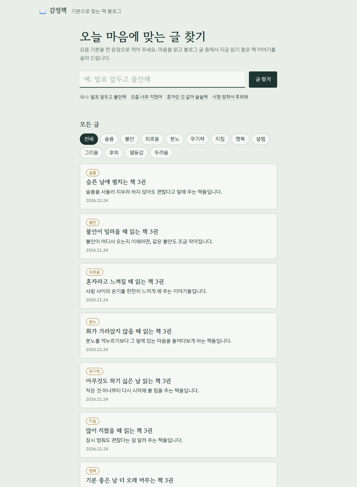

# PRD (Product Requirement Document) · 감정책 블로그

## 1. 기본 정보

| 항목 | 내용 |
|---|---|
| 문서 버전 | v2.0 (v1.0 감정 → 책 추천 서비스를 블로그로 확장) |
| 작성일 | 2026-11-25 |
| 작성자 | ttottibabo |
| 과제 주제 | 내 블로그에 독자 또는 관리자(나)를 위한 AI 기능을 구현(기획 → 디자인 → 개발)해 워크플로우를 자동화하기 |
| 서비스 URL | 방문자: https://ttottibabo.github.io/emotionbook/ · 관리자: https://ttottibabo.github.io/emotionbook/admin.html |
| 관련 문서 | [DECISION_LOG](DECISION_LOG.md) · [TEST_REPORT](TEST_REPORT.md) · [WORKLOG](WORKLOG.md) · [SUCCESS_FAILURE_LOG](SUCCESS_FAILURE_LOG.md) · [AI 중계 서버](../worker/README.md) · [프로토타입 v4](../prototype.html) |

---

## 2. 개요

> **"오늘 기분, 한 문장이면 맞는 책 이야기."**
> **"책 제목과 메모만 쓰면, 발행 준비는 AI가."**

- **배경:** 책 리뷰 블로그는 글이 쌓일수록 좋아지지만, 1인 운영자에게는 글 한 편을 발행하는 데 드는 반복 작업(제목 짓기, 요약, 태그, 검색 설명, SNS 홍보 문구)이 큽니다. 독자는 독자대로, 글이 많아질수록 **지금 내 기분에 맞는 글**을 찾기 어렵습니다.
- **문제:**
  - **관리자(나):** 리뷰 하나를 쓰면 같은 내용을 제목, 요약, 태그, 검색 설명, 인스타 카드 문구로 여러 번 다시 써야 해서 발행이 미뤄집니다.
  - **독자:** 카테고리나 최신순으로는 "지금 내 마음"에 맞는 글을 고르기 어렵고, 감정 단어 없이 상황만 말하면 기존 규칙 방식은 알아듣지 못합니다.
- **솔루션:** 감정 기반 책 블로그 **감정책**에 Claude AI 기능 두 가지를 넣습니다.
  1. **관리자용 AI 발행 도우미:** 책 제목과 메모만 쓰면 Claude가 제목, 한 줄 요약, 감정 분류, 태그, 검색 설명, 본문 정리, 인스타 카드뉴스 문구를 한 번에 만듭니다. 운영자는 확인하고 고친 뒤 발행합니다.
  2. **독자용 AI 글 찾기:** 독자가 기분을 한 문장으로 적으면 Claude가 문장 전체를 읽고, 블로그 글 중에서 맞는 글을 골라 이유와 함께 보여 줍니다.
  - 자해·자살 표현은 AI보다 먼저 규칙으로 걸러 **자살예방 상담전화 109**를 안내합니다. 독자 문장은 저장하지 않습니다.

---

## 3. 문제

### 3.1 데스크리서치

#### 3.1.1 SWOT 분석

| | 긍정 요인 | 부정 요인 |
|---|---|---|
| **내부** | **S (강점)** · v1.0에서 검증한 감정 사전·책 목록·안전장치를 그대로 재사용 · AI가 실패해도 규칙 방식으로 자동 전환되는 구조 · 독자 문장 미저장, 가입 없음 · 서버 비용 거의 없음 (GitHub Pages, Firebase·Cloudflare 무료 요금제) | **W (약점)** · 1인 운영이라 글 수가 적음 (기본 글 12편에서 시작) · AI 호출에 크레딧이 들어 사용량 제한이 필요 · 블로그 인지도 없음 |
| **외부** | **O (기회)** · 생성형 AI로 1인 크리에이터의 반복 작업을 줄이는 흐름 · 북스타그램, 책 큐레이션 콘텐츠 인기 · 20~30대의 마음 건강·자기 돌봄 관심 | **T (위협)** · 범용 AI 챗봇에 직접 책 추천을 물을 수 있음 · AI가 만든 글에 대한 신뢰 문제 (없는 내용을 지어냄) · 정신 건강 관련 표현에 대한 책임 |

#### 3.1.2 3C 분석

| 구분 | 분석 |
|---|---|
| **Customer (고객)** | ① **관리자(나):** 책을 읽고 기록하는 건 좋아하지만, 발행용으로 여러 형태의 글을 다시 쓰는 일이 귀찮아 글이 쌓이지 않는다. ② **독자:** 감정 기복이 큰 시기의 20~30대. 지금 기분에 맞는 책 이야기를 가볍게 읽고 싶다. |
| **Competitor (경쟁)** | ① **일반 블로그 플랫폼(티스토리, velog 등):** 글쓰기 편하지만 발행용 요약·태그·SNS 문구는 직접 써야 하고, 내 맞춤 AI 기능을 붙이기 어렵다. ② **범용 AI 챗봇:** 요약은 해 주지만 블로그 형식에 맞게 매번 질문하고 복사해야 하고, 결과가 블로그 데이터(감정 분류·태그)로 바로 들어가지 않는다. ③ **도서 앱 큐레이션:** 판매·장르 중심이라 감정 기준 탐색이 어렵다. |
| **Company (자사)** | v1.0 감정 추천 서비스와 운영 지표 화면을 이미 만들었다. 규칙 vs AI 비교 프로토타입(v4) 경험이 있다. 과정에서 받은 Claude API 키(무료 크레딧)를 쓸 수 있다. |

### 3.2 문제 발굴

#### 3.2.1 문제 목록

| # | 문제 | 대상 | 솔루션 아이디어 |
|---|---|---|---|
| P1 | 글 한 편 발행에 제목·요약·태그·설명·SNS 문구를 따로 써야 해서 오래 걸린다 | 관리자 | **AI 발행 도우미** (한 번에 생성 → 확인 후 발행) |
| P2 | 발행이 늦어져 블로그에 글이 쌓이지 않는다 | 관리자 | 초안 저장, 발행/내리기 한 번에 |
| P3 | 감정 단어 없이 상황만 말하면 맞는 글을 못 찾는다 | 독자 | **AI 글 찾기** (문장 전체 이해) |
| P4 | 글이 많아지면 지금 기분에 맞는 글을 찾기 어렵다 | 독자 | 감정 필터, 감정 기반 추천 |
| P5 | 힘든 순간에는 책보다 도움이 먼저 필요하다 | 독자 | AI보다 먼저 위기 표현 검사 → 109 |
| P6 | AI가 좋아졌는지, 시간이 줄었는지 알 수 없다 | 관리자 | 작성 시간·AI 사용·방식별 만족도 지표 |

### 3.3 문제 검증

#### 3.3.1 설문 조사 계획

| 항목 | 내용 |
|---|---|
| 목적 | P1(발행 반복 작업)이 블로그 운영자에게 실제 부담인지, P3(상황만 말한 문장)이 독자 입력에서 얼마나 나오는지 확인 |
| 대상 | ① 블로그·SNS에 글을 쓰는 사람 10명 ② 20~30대 독자 30명 |
| 방법 | 온라인 설문 (구글 폼) + 운영자 3명 인터뷰 + 내 글쓰기 시간 직접 측정 |
| 기간 | 2026-11-25 ~ 2026-12-01 |
| 주요 질문 | ① 글 한 편을 발행할 때 본문 외 작업(제목·요약·태그·SNS 문구)에 얼마나 걸리나요? ② 그 작업이 귀찮아 발행을 미룬 적이 있나요? ③ 기분을 적어 글을 추천받는다면 어떻게 쓰겠습니까? (자유 입력 → 감정 단어 포함 비율 측정) ④ AI가 내 글을 정리하는 것에 대한 걱정은? |
| 검증 기준 | ①에서 평균 15분 이상 → P1 검증 / ③에서 감정 단어 없는 문장 20% 이상 → P3 검증 |

#### 3.3.2 설문 조사 결과 및 인사이트

> ⏳ 설문 진행 후 작성합니다. 결과에 따라 기획을 바꾸면 DECISION_LOG에 기록합니다.

| 질문 | 결과 | 인사이트 |
|---|---|---|
| ① | | |
| ② | | |
| ③ | | |
| ④ | | |

**이미 확인한 인사이트**
- **프로토타입 v4 (2026-11-11):** 감정 단어가 분명한 문장은 규칙과 AI 결과가 같았고, 부정문·상황 문장에서만 차이가 났다. → 독자용 AI는 **규칙을 대체하지 않고 보완**하며, AI가 실패하면 규칙으로 돌아가도록 설계했다.
- **v1.0 알려진 한계 (2026-11-24):** "팀장한테 깨졌어", "엄마한테 미안해", "이제 불안하지 않아"를 규칙 방식이 읽지 못했다 (TEST_REPORT K1~K3). → AI 글 찾기의 첫 번째 확인 문장으로 쓴다.

### 3.4 문제 최종 정의

#### 3.4.1 우선 순위 결정 (RICE)

점수는 1인 개발 기준 추정치입니다. Reach(월 영향 횟수 추정), Impact(0.25~3), Confidence(%), Effort(인·주).

| 문제 | Reach | Impact | Confidence | Effort | **RICE** | 결정 |
|---|---|---|---|---|---|---|
| P5 위기 안내 | 800 | 3 | 100% | 0.5 | **4800** | ✅ Must (안전) |
| P1 발행 반복 작업 (AI 발행 도우미) | 40 | 3 | 80% | 1 | **96** | ✅ Must (과제 핵심: 관리자 워크플로우 자동화) |
| P3 상황 문장 이해 (AI 글 찾기) | 800 | 2 | 70% | 1 | **1120** | ✅ Must |
| P4 감정 기반 탐색 | 800 | 1 | 80% | 0.5 | **1280** | ✅ Should |
| P6 자동화 효과 측정 | 40 | 2 | 80% | 0.5 | **128** | ✅ Should |
| P2 초안·발행 관리 | 40 | 1 | 80% | 0.5 | **64** | ✅ Should |

> P1은 대상이 운영자 1명이라 Reach 점수가 낮지만, 과제 주제(워크플로우 자동화)의 핵심이고 블로그 글 수를 늘려 독자 쪽 가치(P3, P4)를 함께 키우므로 Must로 정했습니다.

**제외한 것:** 독자 회원가입·댓글(개인정보와 운영 부담), AI 자동 발행(사람 확인 없이 발행하면 지어낸 내용이 나갈 위험) → [DECISION_LOG D-010](DECISION_LOG.md)

#### 3.4.2 문제 최종 정의

> **"1인 책 블로그 운영자는 리뷰 한 편을 발행하려고 같은 내용을 여러 형태로 다시 쓰느라 발행을 미루고, 그 결과 독자는 지금 기분에 맞는 글을 찾을 만큼 충분한 글을 만나지 못한다."**

---

## 4. 해결 방안

### 4.1 솔루션 정의

> **관리자는 책 제목과 메모만 쓰면 AI가 발행에 필요한 나머지를 채우고, 독자는 기분 한 문장으로 맞는 글을 찾는다. 두 흐름 모두 AI가 실패하면 규칙 방식으로 이어지고, 위험 신호는 AI보다 먼저 잡는다.**

| 문제 | 세부 솔루션 |
|---|---|
| P1 | 관리자 글쓰기 화면의 **[✨ AI로 나머지 채우기]**: 제목, 한 줄 요약, 감정, 태그, 검색 설명, 본문 정리, 인스타 카드 문구를 한 번에 생성. 모든 칸은 고칠 수 있음 |
| P2 | 초안 저장 / 발행 / 내리기 / 삭제를 글 목록에서 바로 |
| P3 | 독자 문장을 Claude가 읽고 블로그 글 목록에서만 골라 이유와 함께 추천. 목록에 없는 글은 버림 |
| P4 | 감정 12가지 필터, 글 보기 아래 "같은 마음의 다른 글" |
| P5 | 위기 표현은 브라우저와 AI 중계 서버 양쪽에서 AI보다 먼저 검사, 109 안내 |
| P6 | 글마다 작성 시간과 AI 사용 여부를 저장하고, 지표 화면에 AI/직접 작성 평균 시간과 방식별 만족도를 표시 |

### 4.2 AS-IS / TO-BE

**관리자 발행 워크플로우**

| 단계 | AS-IS (직접) | TO-BE (AI 발행 도우미) |
|---|---|---|
| 1. 메모·본문 | 직접 작성 | 직접 작성 (내 생각은 내가 씀) |
| 2. 제목·요약 | 여러 번 고쳐 씀 | AI가 제안 → 확인 |
| 3. 감정 분류·태그 | 직접 고민 | AI가 제안 → 확인 |
| 4. 검색 설명 | 글자 수 맞춰 따로 씀 | AI가 80자 안으로 제안 |
| 5. 인스타 카드 문구 | SNS 앱에서 따로 씀 | AI가 제안 → 복사 버튼 |
| 걸리는 시간 (목표) | 약 25분 | **약 10분 (50% 이상 단축)** |

**독자 글 찾기**

| | AS-IS (v1.0 규칙) | TO-BE (AI + 규칙) |
|---|---|---|
| "발표 앞두고 불안해" | 불안 → 책 3권 | 불안 → 맞는 글 + 이 문장에 맞춘 이유 |
| "팀장한테 깨졌어" | 감정 못 찾음 → 직접 선택 | AI가 상황을 읽고 글 추천 |
| AI 실패·미연결 | – | 자동으로 규칙 방식 |

- **컨셉:** 감정으로 찾는 책 블로그. 사람(운영자)이 쓰고 AI가 정리를 돕는다.
- **타깃:** 관리자(나), 감정 기복이 큰 시기의 20~30대 독자 (5.2 페르소나)
- **비즈니스 모델 및 가격 정책:** 무료, 광고 없음. 이후 온라인 서점 제휴 링크, 출판사 신간 큐레이션 협업 검토. AI 비용은 무료 크레딧 안에서 운영하고, 독자용 요청은 IP당 1분 10회로 제한.
- **기능:** 6장 · **디자인:** 8장

### 4.3 예상 성과

- AI 발행 도우미로 **글 한 편 작성 시간을 50% 이상 줄인다.**
- 그 결과 **주 1편 → 주 3편**으로 발행량을 늘린다.
- AI 글 찾기로 독자의 **"감정 못 찾음" 비율을 5% 이하**로 낮춘다 (v1.0 규칙 목표 20%).

**OKR (출시 후 4주)**
- **O1 (관리자):** 리뷰 발행을 귀찮은 일에서 10분짜리 일로 바꾼다.
  - KR1: AI 도움 글의 평균 작성 시간이 직접 작성보다 50% 이상 짧다
  - KR2: 4주 동안 새 글 12편 발행
- **O2 (독자):** 어떤 문장으로 적어도 맞는 글을 찾게 한다.
  - KR3: 감정 못 찾음 5% 이하
  - KR4: 추천 만족도(👍 비율) 70% 이상, AI 방식이 규칙 방식보다 높을 것

---

## 5. 가설 및 지표

### 5.1 핵심 지표 (Key Metrics)

**북극성 지표: 주간 발행 글 수 × 글이 받은 👍** (운영자가 쉽게 쓰고, 독자가 도움을 받은 만큼)

| 가설 | 측정 지표 | 정의 (데이터) | 목표 |
|---|---|---|---|
| H1. AI 발행 도우미가 작성 시간을 줄인다 | 평균 작성 시간 (AI vs 직접) | `posts.editSeconds`를 `aiUsed`로 나눠 평균 | AI가 50% 이상 짧음 |
| H2. 작성이 쉬워지면 발행이 늘어난다 | 주간 발행 수 | `posts.status = published` 주별 건수 | 주 3편 |
| H3. AI가 상황 문장도 읽는다 | 감정 못 찾음 비율 | `miss ÷ (recommend + miss)` | 5% 이하 |
| H4. AI 추천이 규칙 추천보다 도움이 된다 | 방식별 만족도 | `feedback.method`별 👍 비율 | AI ≥ 규칙, 전체 70% |
| H5. 맞는 글은 끝까지 읽히고 공유된다 | 글 조회·공유 | `events.type = view / share` | 추천 대비 조회 50%, 공유 5% |

**지표에 따른 운영 행동**
- H1 실패 → 도우미 결과 중 가장 많이 고친 칸을 찾아 프롬프트 수정 (`worker/src/index.js`)
- H3 실패 → 실패 문장 유형을 기록해 프롬프트와 감정 사전 보강
- H4에서 AI < 규칙 → AI 추천 이유 문구 점검, 모델 변경 검토 (`MODEL`)
- 크레딧 소진 위험 → 모델을 `claude-haiku-5-5`로 바꾸거나 독자용 요청 제한 강화

모든 지표는 관리자 화면 → **지표** 탭에서 확인합니다.

### 5.2 고객 정의 (Persona)

| 유형 | 상황 | 니즈 |
|---|---|---|
| **관리자 (1순위, 워크플로우 자동화 대상)** | 책을 읽고 메모는 남기지만 발행은 미룸 | 메모만 쓰면 나머지가 준비되는 발행 과정 |
| 독자 A. 지친 사회초년생 | 야근과 적응 스트레스 | 퇴근 후 가볍게 위로받을 글 |
| 독자 B. 시험·취업 준비생 | 시험 기간, 불합격 경험 | 불안과 자책을 다룬 글 |

> **나 (관리자, ttottibabo)**
> - 책을 읽으면 휴대폰 메모에 감상을 몇 줄 남긴다.
> - "메모는 금방 쓰는데, 블로그에 올리려면 제목, 요약, 태그, 인스타 문구까지 다시 써야 해서 결국 안 올리게 돼요."
> - 원하는 것: 내 메모의 말투는 지키면서 발행 준비를 대신해 주는 도우미, 내가 확인하고 고칠 수 있을 것

> **김지원 (가상 독자, 26세, 입사 6개월 차)**
> - "오늘 팀장한테 깨졌는데, 뭔가 위로되는 걸 읽고 싶어요." → 감정 단어가 없어도 맞는 글을 찾고 싶다.

### 5.3 마케팅 메시지

- **독자용 핵심 카피:** "오늘 기분, 한 문장이면 맞는 책 이야기."
- **과제 발표용 카피:** "책 제목과 메모만 쓰면, 발행 준비는 AI가."
- **보조 카피:** "적은 문장은 저장하지 않아요." / "가입 없이 바로."

| 쓰는 말 | 쓰지 않는 말 | 이유 |
|---|---|---|
| 지금 마음, 기분 | 감정 상태, 심리 진단 | 진단처럼 느껴지지 않게 |
| AI가 채우는 부분 (고칠 수 있어요) | AI가 쓴 글 | 글의 주인은 운영자 |
| 감정을 찾지 못했어요 | 오류, 인식 실패 | 사용자 탓처럼 들리지 않게 |

---

## 6. 기능적 요구사항 (Functional Requirements)

### 6.1 주요 기능 리스트

**방문자 페이지 (`index.html`)**

| ID | 기능 | 우선순위 | 상태 | 구현 위치 |
|---|---|---|---|---|
| F1 | 글 목록 (기본 글 12편 + 발행한 글), 감정 필터 12개 | Must | ✅ | `js/app.js`, `js/posts.js` |
| F2 | 글 보기 (`?p=글id`): 본문, 책, 태그, 같은 마음의 다른 글, 공유 | Must | ✅ | `js/app.js` |
| F3 | **AI 글 찾기:** 문장 → Claude가 감정과 글 최대 3개, 이유, 한마디 | Must | ✅ (Worker 배포 대기) | `js/ai.js`, `worker/` |
| F4 | AI 실패·미연결 시 규칙 방식 (감정 사전 → 같은 감정 글) | Must | ✅ | `js/recommend.js` |
| F5 | 위기 표현 → 109 안내 (AI보다 먼저, 서버에서도 한 번 더) | Must | ✅ | `js/recommend.js`, `worker/src/index.js` |
| F6 | 감정 못 찾음 → 감정 12개 직접 선택 | Must | ✅ | `js/app.js` |
| F7 | 추천 근거 공개 ("어떻게 골랐나요?": AI/규칙 구분) | Should | ✅ | `js/app.js` |
| F8 | 피드백 👍/👎, 공유 링크 (`?emo=`, `?p=`) | Should | ✅ | `js/app.js` |

**관리자 페이지 (`admin.html`)**

| ID | 기능 | 우선순위 | 상태 | 구현 위치 |
|---|---|---|---|---|
| F9 | 로그인 + 관리자 확인 (`admins/{uid}`) | Must | ✅ (Firebase 연결 대기) | `js/admin.js` |
| F10 | **AI 발행 도우미:** 책 제목·메모 → 제목, 요약, 감정, 태그, 검색 설명, 본문 정리, 카드 문구 | Must | ✅ (Worker 배포 대기) | `js/admin.js`, `worker/` |
| F11 | 글쓰기: 모든 칸 수정, 초안 저장, 발행 (필수 칸 검사), 카드 문구 복사 | Must | ✅ | `js/admin.js`, `js/store.js` |
| F12 | 글 목록: 고치기, 발행/내리기, 삭제(확인 창) | Should | ✅ | `js/admin.js` |
| F13 | 지표: 독자(추천·만족도·못 찾음·조회·위기), 글쓰기 자동화(AI 글 수·평균 작성 시간·줄어든 시간), 방식 비교, 많이 본 글 | Should | ✅ | `js/admin.js` |
| F14 | 예시 모드 (`?demo=1`): Firebase 없이 모든 화면 체험, 저장 안 됨 | Could | ✅ | `js/admin.js` |

### 6.2 유즈케이스 시나리오

**UC1. 관리자: AI로 리뷰 발행 (핵심 워크플로우)**
1. 관리자가 `admin.html`에 로그인한다 → `admins/{uid}` 확인.
2. 글쓰기 탭에서 책 제목 "월든", 저자, 메모 몇 줄을 쓴다. (작성 시간 측정 시작)
3. [✨ AI로 나머지 채우기]를 누른다 → 브라우저가 로그인 토큰과 함께 Worker `/assist`로 보낸다.
4. Worker가 토큰으로 관리자임을 확인하고 Claude에 정해진 JSON 형식으로 요청한다.
5. 제목, 요약, 감정(지침), 태그, 검색 설명, 본문, 카드 문구가 채워진다.
6. 관리자가 고칠 곳을 고치고 [발행]을 누른다 → `posts`에 `aiUsed: true`, `editSeconds`와 함께 저장.
7. [카드 문구 복사]로 인스타그램에 붙여 넣는다.
- **예외:** AI 실패 → "규칙으로 대신 채웠습니다" 안내, 규칙 도우미 결과로 계속 작성.

**UC2. 독자: 상황만 말한 문장으로 글 찾기**
1. 독자가 "팀장한테 깨졌어"를 입력한다.
2. 브라우저가 위기 표현을 먼저 검사한다 → 없음.
3. Worker `/recommend`로 문장과 글 목록(id·제목·감정·요약)을 보낸다.
4. Claude가 감정(예: 분노)과 글 1~3개, 이유, 한마디를 돌려준다. 목록에 없는 id는 버린다.
5. 결과 카드를 누르면 글 보기로 이동한다 (`view` 기록).
- **예외:** AI 오류·시간 초과(20초) → 규칙 방식. 규칙도 못 찾으면 감정 12개 버튼.

**UC3. 위기 표현**
1. "다 끝내고 싶다" → 브라우저에서 바로 109 안내 (AI 호출 안 함). AI가 위기라고 판단해도 109 안내.

**UC4. 공유 링크**
1. `?p=seed-06` 또는 `?emo=불안` 링크로 들어오면 그 글 또는 그 감정의 글이 바로 보인다.

**UC5. 자동화 효과 확인**
1. 관리자가 지표 탭에서 AI 도움 글과 직접 쓴 글의 평균 작성 시간, 줄어든 비율, 방식별 만족도를 본다.

### 6.3 기능 정의 상세

| 기능 | 정의 |
|---|---|
| AI 중계 서버 | Cloudflare Worker. Claude API 키는 Worker Secret에만 보관. 허용된 사이트(origin)에서 온 요청만 받음 |
| AI 모델 | 기본 `claude-opus-5-5`, `MODEL` 변수로 변경 가능. 독자용 effort `low`, 관리자용 `medium`. 응답은 JSON Schema로 형식 고정(structured outputs). 안전 분류기 거절 시 서버 측 fallback |
| 관리자 확인 (AI) | Firebase 로그인 토큰으로 Firestore `admins/{uid}` 문서를 읽어 봄. 토큰이 가짜면 Firestore가 거부 |
| 사용량 제한 | `/recommend` IP당 1분 10회 (Cloudflare rate limit) |
| 감정 인식 (규칙) | 공백 제거 후 감정 사전 순서대로 단어 포함 여부 확인 |
| 위기 표현 | `죽고, 죽을래, 자살, 자해, 사라지고싶, 끝내고싶` |
| 데이터 | `posts { title, summary, emotion, tags, description, card, body, bookTitle, bookAuthor, status, aiUsed, editSeconds, createdAt, updatedAt }` `events { type: recommend·miss·crisis·share·view, emotion, word, source, method: rule·ai, post, sid, ts }` `feedback { emotion, vote, method, sid, ts }` |

---

## 7. 비기능적 요구사항 (Non-Functional Requirements)

| 구분 | 요구사항 | 근거 / 방법 |
|---|---|---|
| 동시 접속자 수 | 100명 동시 사용에 문제없을 것 | 정적 페이지(GitHub Pages CDN), Worker는 요청마다 실행 |
| 성능 | 첫 화면 2초, 규칙 추천 0.1초, AI 추천 10초 이내 (20초 넘으면 규칙으로) | `js/ai.js` 시간 제한, 독자용 effort `low` |
| 가용성 | Firebase·Worker·Claude 중 하나가 멈춰도 글 보기와 규칙 추천은 동작 | 기본 글은 코드에 포함, AI 실패 시 규칙으로 |
| 보안 | Claude API 키가 브라우저·GitHub에 노출되지 않을 것 | Worker Secret, `.gitignore`, AGENT_GUIDE 규칙 5 |
| 보안 | 글 쓰기·초안 읽기는 관리자만, 기록은 추가만 | `firestore.rules` |
| 보안 | 프롬프트 인젝션: 독자 문장·메모 안의 지시를 따르지 않을 것 | 시스템 프롬프트 지시, JSON 형식 고정, 글 id 검증 |
| 보안 | XSS: 입력과 AI 답을 모두 이스케이프 | `esc()`, 화면 테스트 U11 |
| 개인정보 | 독자 문장은 감정을 읽기 위해 Claude에 보내지만 저장하지 않음. 화면에 고지 | D-003 개정 (D-009) |
| 비용 | 월 0원 + Claude 무료 크레딧 | GitHub Pages, Firebase Spark, Cloudflare 무료, 요청 제한 |
| 접근성 | 키보드 사용, 결과 변경 알림, 탭 상태 표시 | `aria-live`, `aria-pressed`, `aria-current` |
| 호환성 | 모바일 375px 가로 스크롤 없음, 다크 모드 | 스크린샷 03 |

---

## 8. 디자인 요구사항

- **UX/UI 방향성**
  - **방문자:** 위에는 "오늘 마음에 맞는 글 찾기" 입력창, 아래에는 모든 글과 감정 필터. 글 보기는 읽기에 집중한 한 단 구성.
  - **관리자:** 탭 3개(글쓰기 · 글 목록 · 지표). 글쓰기는 **"1. 내가 쓰는 부분"**과 **"2. AI가 채우는 부분 (고칠 수 있어요)"**으로 나눠, 무엇을 사람이 쓰고 무엇을 AI가 돕는지 분명히 보여 준다.
  - 차분한 초록·회색 배경, 제목은 명조체(Gowun Batang), 본문은 IBM Plex Sans KR. 감정은 금색 테두리 칩.
  - 위기 안내는 다른 색 박스로 분명하게 구분.
- **프로토타입·화면 자료**
  - 프로토타입 v4 (규칙 vs AI 비교): [`prototype.html`](../prototype.html)
  - 관리자 예시 모드: https://ttottibabo.github.io/emotionbook/admin.html?demo=1
  - 화면 캡처: [`docs/screenshots/`](screenshots/)

| 블로그 첫 화면 | 추천 결과 (모바일) | 관리자 글쓰기 (도우미 결과) | 관리자 지표 |
|---|---|---|---|
|  |  |  |  |

---

## 9. 출시 및 운영 전략

### 9.1 개발 범위 선정
- **v2.0 (이번):** F1~F14. 방문자·관리자 페이지, AI 발행 도우미, AI 글 찾기, 규칙 대체 경로
- **v2.1:** 도우미 결과 중 운영자가 고친 칸 기록(프롬프트 개선용), og:image 카드 이미지 자동 생성
- **v3.0 (검토):** 독자 피드백을 모아 주간 "이번 주 많이 찾은 마음" 글 초안 자동 생성

### 9.2 출시 방식 및 일정
| 시점 | 할 일 |
|---|---|
| 2026-11-25 | 블로그 v2.0 GitHub Pages 배포 (AI 미연결 상태: 규칙 방식으로 동작) ✅ |
| 2026-11-25 ~ 11-27 | Firebase 연결, Cloudflare Worker 배포, `AI_ENDPOINT` 입력 → AI 기능 켜기 |
| 2026-11-27 ~ 12-01 | 직접 리뷰 6편 작성 (AI 3편 / 직접 3편)으로 작성 시간 비교, 설문, 지인 10명 베타 |
| 2026-12-02 | 정식 홍보: 도우미가 만든 카드 문구로 인스타그램 게시 시작 |
| 출시 후 4주 | 지표 회고 → v2.1 범위 결정 |

**마케팅 채널**
| 채널 | 실행 | 측정 |
|---|---|---|
| 인스타그램 | 새 글마다 AI가 만든 카드 문구로 게시 (주 3회) | `?utm_source=instagram` |
| 대학 커뮤니티 | 시험 기간 "불안할 때 읽는 글" 소개 | `?utm_source=community` |
| 블로그 내 공유 | 글·감정 공유 버튼 | `source = link`, `share` |

**운영 방식**
| 항목 | 방법 |
|---|---|
| 정기 점검 | 매주 월요일 지표 탭 확인 → WORKLOG에 기록 |
| AI 비용 | Anthropic 콘솔에서 주 1회 사용량 확인, 크레딧 50% 소진 시 모델 변경 검토 |
| 콘텐츠 | 주 3편 발행 목표, 만족도 낮은 감정의 글 우선 보강 |
| 안전 | 위기 표현 목록 분기별 검토, 109 문구 유지 |

### 9.3 테스트 방식 및 일정
| 테스트 | 방식 | 시점 | 결과 |
|---|---|---|---|
| 로직 테스트 | `tests/run.html` (55개, 가짜 AI 서버 포함) | 매 수정 시 | ✅ 통과 |
| 화면 테스트 | `tests/ui.html` 방문자 13개 + 관리자 7개 | 매 수정 시 | ✅ 통과 |
| AI 실제 호출 | Worker 배포 후 K1~K3 문장, 도우미 3회 | Worker 배포 직후 | ⏳ 예정 |
| 보안 규칙 | Firebase Rules Playground 6개 시나리오 | Firebase 연결 직후 | ⏳ 예정 |
| 베타 테스트 | 지인 10명 + 내 작성 시간 측정 | 11-27 ~ 12-01 | ⏳ 예정 |

상세: [TEST_REPORT](TEST_REPORT.md)

### 9.4 리스크 및 해결 전략
| 리스크 | 영향 | 해결 전략 |
|---|---|---|
| 위기 표현을 놓침 | 매우 큼 | AI보다 먼저 규칙 검사 (브라우저 + Worker), AI도 위기 판단, 푸터 109 상시 |
| API 키 유출 | 큼 | Worker Secret에만 보관, 코드·GitHub에 없음, 유출 시 콘솔에서 즉시 폐기 |
| 크레딧 소진·남용 | 중간 | 사용 사이트 제한, IP당 요청 제한, 실패 시 규칙 방식, 모델 변경 가능 |
| AI가 없는 내용을 지어냄 | 중간 | 프롬프트로 금지, 발행 전 사람 확인 필수(자동 발행 없음), 추천은 목록 안 글만 |
| 프롬프트 인젝션 | 중간 | 입력을 태그로 감싸고 지시 무시 명시, JSON 형식 고정, 결과 검증 |
| 관리자 외 글 작성 | 큼 | Firestore 규칙 + Worker 관리자 확인 |

---

## 10. 일정 및 리소스

| 단계 | 일정 | 담당자 | 비고 |
|---|---|---|---|
| 기획 | 2026-11-11 ~ 11-25 | ttottibabo | v1.0 감정 추천 → v2.0 블로그 + AI 자동화로 확장 |
| 디자인 | 2026-11-25 | ttottibabo + Claude Code | 방문자·관리자 화면, 글쓰기 2단 구성 |
| 개발 | 2026-11-25 | ttottibabo + Claude Code | 블로그, 관리자, Worker, 보안 규칙 |
| QA/테스트 | 2026-11-25 ~ 12-01 | ttottibabo | 자동 테스트 75개 통과, AI 실제 호출·보안 규칙·베타 예정 |
| 출시 | 2026-11-25 (배포) / 2026-12-02 (홍보) | ttottibabo | GitHub Pages + Cloudflare Workers |

**리소스:** 1인 프로젝트, 예산 0원 (GitHub Pages, Firebase Spark, Cloudflare Workers 무료) + Claude API 무료 크레딧. 개발 도구로 Claude Code 활용.

---

## 11. 승인

| 역할 | 이름 / 구체적인 확인사항 | 승인 여부 |
|---|---|---|
| PM | ttottibabo 1. 관리자 AI 발행 도우미를 핵심 기능으로 하는 범위 2. 독자 문장을 Claude에 보내되 저장하지 않는 정책 (D-009) 3. AI 결과는 사람이 확인한 뒤에만 발행 (D-010) | ✅ |
| Tech Lead | OOO (멘토·강사 검토) 1. API 키 보관 방식 (Worker Secret) 2. Firestore 규칙과 Worker 관리자 확인 | ✅/❌ |
| Biz Owner | OOO 1. 무료 크레딧 안에서의 운영 방식 2. 위기 안내 문구와 책임 범위 | ✅/❌ |

## 12. Q&A

| 직무 | 질문사항 | 답변자 | 비고 |
|---|---|---|---|
| 기획 | 1. 도우미가 만든 제목을 그대로 쓰는 비율은 얼마일까? 2. 독자 문장을 AI에 보내는 것을 독자가 꺼리지는 않을까? | | 베타 인터뷰로 확인 |
| 디자인 | 1. "AI가 채운 칸"을 색으로 표시할까? 2. 글 보기에 표지 이미지를 넣을까? | | |
| 개발 | 1. 무료 크레딧으로 하루 몇 건까지 가능한가? 2. 도우미 결과를 스트리밍으로 보여 줄 필요가 있는가? | | Worker 배포 후 측정 |
| QA/테스트 | 1. 프롬프트 인젝션 문장 예시를 몇 개 더 시험할까? 2. 보안 규칙 시나리오 6개 외 추가로 볼 것은? | | |
| 마케팅팀 | 1. AI가 만든 카드 문구의 반응이 직접 쓴 문구와 다른가? | | utm으로 비교 |
| 운영팀 | 1. 크레딧이 끝나면 AI를 끌지, 모델을 바꿀지? 2. 위기 안내가 자주 뜨면 추가 조치는? | | |
