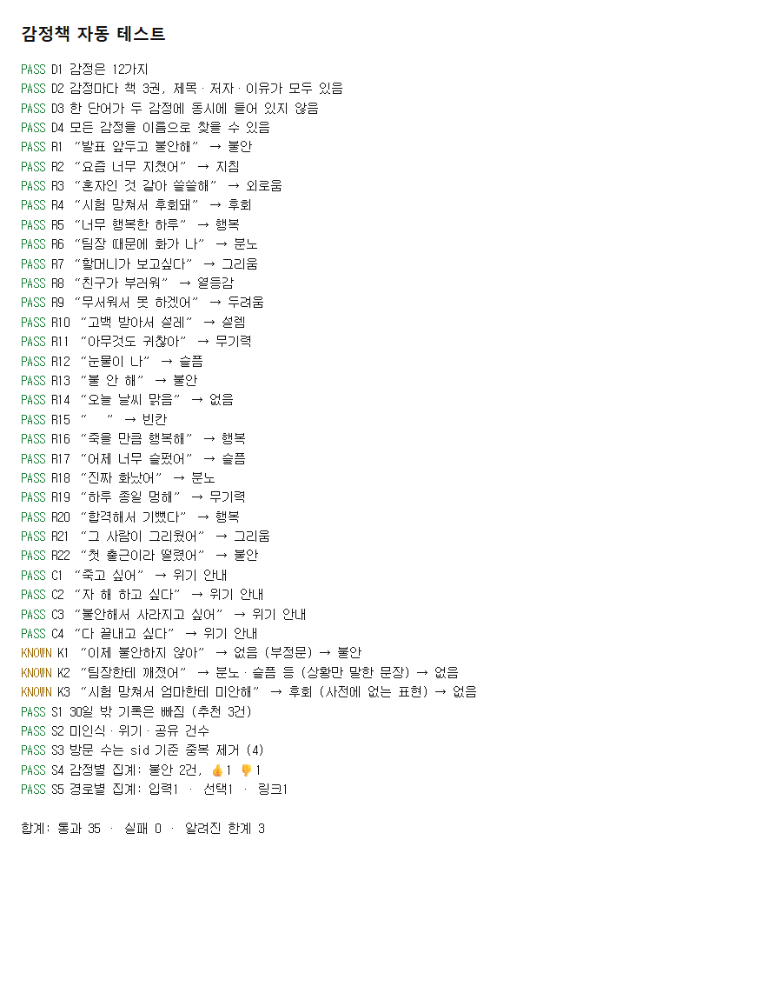
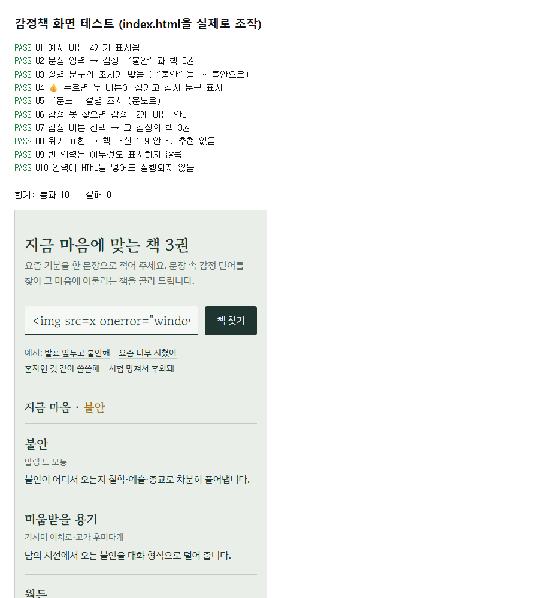

# TEST REPORT

- 테스트 날짜: 2026-11-24
- 대상: v1.0 공개판 (`index.html`, `admin.html`, `js/`)
- 환경: Windows 11, Chrome (헤드리스), 파일로 직접 열기

## 결과 요약

| 구분 | 파일 | 통과 | 실패 | 알려진 한계 |
|---|---|---|---|---|
| 로직 테스트 | `tests/run.html` | 35 | 0 | 3 |
| 화면 테스트 | `tests/ui.html` | 10 | 0 | – |
| 화면 확인 | `docs/screenshots/` | 7장 | – | – |
| 보안 규칙 | `firestore.rules` | **미검증** | – | – |



## 실행 방법

브라우저에서 `tests/run.html`, `tests/ui.html`을 열면 결과가 바로 나옵니다. Chrome에서 파일로 직접 열 때는 모듈 로딩을 위해 아래 옵션이 필요합니다.

```powershell
& "C:\Program Files\Google\Chrome\Application\chrome.exe" --allow-file-access-from-files tests\run.html
```

로컬 서버(VS Code Live Server 등)로 열거나 배포 주소 뒤에 `/tests/run.html`을 붙여 열어도 됩니다.

## 1. 로직 테스트 (`tests/run.html`)

| ID | 확인 내용 | 결과 |
|---|---|---|
| D1~D4 | 감정 12개, 감정마다 책 3권, 단어 중복 없음, 이름으로 찾기 | ✅ |
| R1~R12 | 감정 12가지 각각 대표 문장으로 인식 | ✅ |
| R13 | 띄어쓰기가 섞인 "불 안 해" → 불안 | ✅ |
| R14~R15 | 감정 없는 문장 → 없음, 빈칸 → 무시 | ✅ |
| R16 | "죽을 만큼 행복해"는 위기 안내가 아니라 행복 | ✅ |
| R17~R22 | 과거형 활용 (슬펐, 화났, 멍해, 기뻤, 그리웠, 떨렸) | ✅ (수정 후) |
| C1~C4 | 위기 표현 (띄어쓰기 섞임, 다른 감정과 섞임 포함) → 109 안내 | ✅ |
| S1~S5 | 운영 지표 집계 (기간 필터, 방문 중복 제거, 감정별·경로별) | ✅ |

### 발견한 버그와 수정
| 버그 | 원인 | 수정 | 확인 |
|---|---|---|---|
| 첫 화면 예시 "요즘 너무 지쳤어" → 감정 못 찾음 | 사전에 과거형 "지쳤" 없음 | 과거형 9개 추가 (DECISION_LOG D-006) | R2, R17~R22 |

### 알려진 한계 (규칙 방식이라 생기는 문제, 실패로 세지 않음)
| ID | 문장 | 기대 | 실제 | 이유 |
|---|---|---|---|---|
| K1 | 이제 불안하지 않아 | 없음 | 불안 | 부정문을 이해하지 못함 |
| K2 | 팀장한테 깨졌어 | 분노·슬픔 등 | 없음 | 감정 단어 없이 상황만 말함 |
| K3 | 시험 망쳐서 엄마한테 미안해 | 후회 | 없음 | "미안"이 사전에 없음 |

K2, K3는 감정 목록에서 직접 고르는 화면으로 이어지므로 사용자가 막히지는 않습니다. 이 비율이 운영자 화면의 "감정 못 찾음"으로 나타나고, 20%를 넘으면 AI 도입을 검토합니다 (DECISION_LOG D-002).

## 2. 화면 테스트 (`tests/ui.html`)

`index.html`을 프레임에 띄워 실제로 입력하고 누릅니다.

| ID | 시나리오 | 결과 |
|---|---|---|
| U1 | 예시 버튼 4개 표시 | ✅ |
| U2 | "발표 앞두고 불안해" 입력 → 불안, 책 3권 | ✅ |
| U3 | 설명 문구 조사 ("불안"을 … 불안으로) | ✅ |
| U4 | 👍 누르면 버튼 잠금, 감사 문구 | ✅ |
| U5 | 분노 → "분노로" (받침 없는 조사) | ✅ |
| U6~U7 | 감정 못 찾음 → 12개 버튼 → 선택하면 책 3권 | ✅ |
| U8 | "다 끝내고 싶다" → 109 안내, 책 목록 없음 | ✅ |
| U9 | 빈 입력 → 아무것도 표시 안 함 | ✅ |
| U10 | HTML 태그 입력 → 실행되지 않음 (XSS 방지) | ✅ |



## 3. 화면 확인 (스크린샷)

| 파일 | 내용 |
|---|---|
| `00_prototype_v4.png` | 이전 프로토타입 (규칙 vs AI 비교) |
| `01_home.png` | 공개판 첫 화면 |
| `02_result_desktop.png` | 추천 결과 (데스크톱, 공유 링크 `?emo=불안`) |
| `03_result_mobile.png` | 추천 결과 (모바일 375px) |
| `04_admin_dashboard_demo.png` | 운영자 화면 (예시 데이터) |
| `05_admin_not_connected.png` | Firebase 미연결 시 운영자 화면 안내 |

모바일 375px에서 가로 스크롤이 없는 것을 확인했습니다. 단어 중간 줄바꿈 문제를 발견해 수정했습니다 (SUCCESS_FAILURE_LOG #6).

## 4. 아직 검증하지 못한 것

| 항목 | 이유 | 검증 방법 |
|---|---|---|
| Firestore 보안 규칙 | 이 PC에 Firebase CLI·에뮬레이터가 없음 | Firebase 연결 후 콘솔의 Rules Playground에서: ① 로그인 없이 `events` 추가 → 허용 ② 로그인 없이 `events` 읽기 → 거부 ③ `type: "hack"` 추가 → 거부 ④ 운영자 계정 읽기 → 허용 |
| 실제 기록 저장과 운영자 로그인 | Firebase 프로젝트 연결 전 | `js/firebase-config.js` 입력 후 추천 1회 → 콘솔에서 문서 확인 |
| 공유 버튼 (휴대폰 공유 창) | 헤드리스 브라우저에는 공유 창이 없음 | 휴대폰에서 직접 눌러 확인 |
| Safari, Firefox | 이번에는 Chrome만 확인 | 배포 후 각 브라우저에서 확인 |
