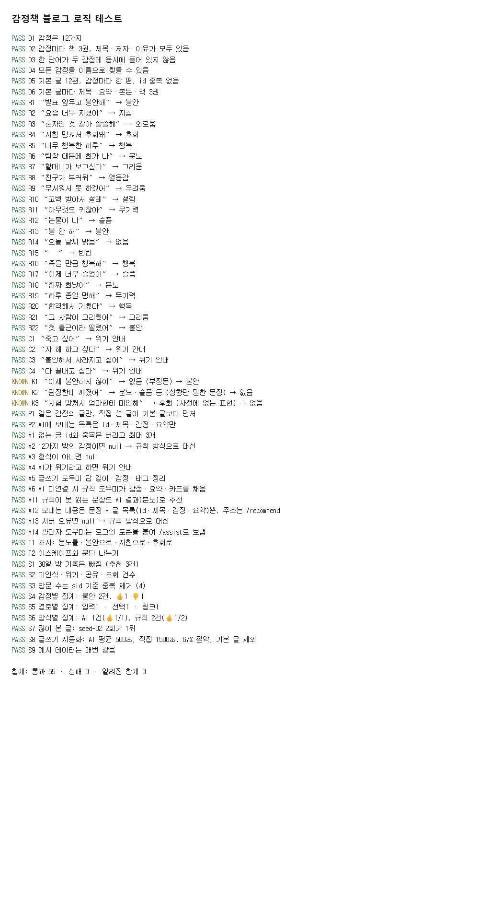
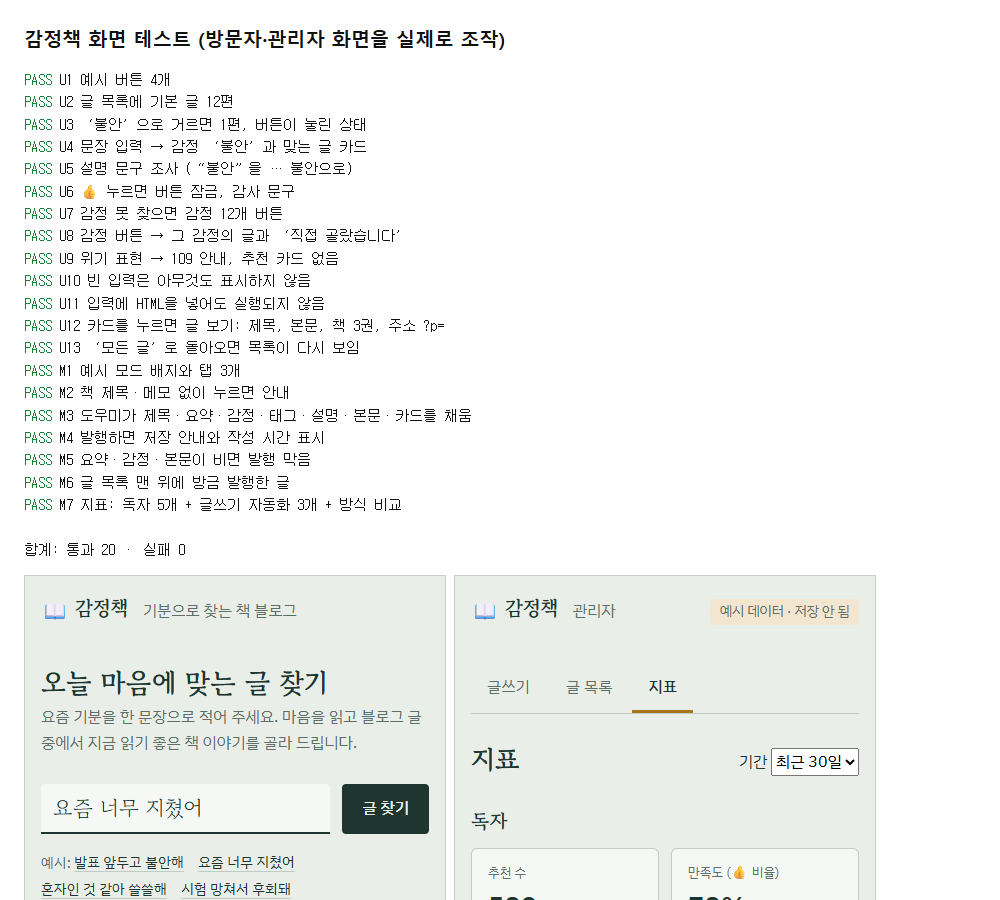

# TEST REPORT

- 테스트 날짜: 2026-11-25
- 대상: v2.0 블로그 (`index.html`, `admin.html`, `js/`, `worker/`)
- 환경: Windows 11, Chrome (헤드리스), 파일로 직접 열기

## 결과 요약

| 구분 | 파일 | 통과 | 실패 | 알려진 한계 |
|---|---|---|---|---|
| 로직 테스트 | `tests/run.html` | 55 | 0 | 3 (규칙 방식) |
| 화면 테스트 | `tests/ui.html` (방문자 13 + 관리자 7) | 20 | 0 | – |
| 화면 확인 | `docs/screenshots/` | 11장 | – | – |
| AI 실제 호출 | `worker/` | **미검증** | – | – |
| 보안 규칙 | `firestore.rules` | **미검증** | – | – |



## 실행 방법

```powershell
& "C:\Program Files\Google\Chrome\Application\chrome.exe" --allow-file-access-from-files tests\run.html
```
```powershell
& "C:\Program Files\Google\Chrome\Application\chrome.exe" --allow-file-access-from-files tests\ui.html
```

로컬 서버(VS Code Live Server 등)로 열거나 배포 주소 뒤에 `/tests/run.html`을 붙여 열어도 됩니다.

## 1. 로직 테스트 (`tests/run.html`)

| ID | 확인 내용 | 결과 |
|---|---|---|
| D1~D6 | 감정 12개, 책 3권씩, 단어 중복 없음, 기본 글 12편(감정마다 한 편) | ✅ |
| R1~R22 | 규칙 감정 인식 (대표 문장, 띄어쓰기, 과거형, 관용 표현) | ✅ |
| C1~C4 | 위기 표현 → 109 안내 | ✅ |
| P1~P2 | 감정에 맞는 글 고르기 (직접 쓴 글 우선), AI에 보내는 목록은 id·제목·감정·요약만 | ✅ |
| A1~A4 | AI 추천 답 검증: 없는 글·중복 제거, 최대 3개, 12가지 밖 감정·잘못된 형식은 버리고 규칙으로, AI 위기 판단 존중 | ✅ |
| A5~A6 | 글쓰기 도우미 답 정리(길이·태그·감정), AI 미연결 시 규칙 도우미 | ✅ |
| AI1~AI4 | **가짜 AI 서버**로 브라우저 흐름 확인: "팀장한테 깨졌어" → 분노 추천, 보내는 데이터 범위, 서버 오류 시 규칙으로, 관리자 요청에 로그인 토큰 첨부 | ✅ |
| T1~T2 | 조사 선택, 이스케이프와 문단 나누기 | ✅ |
| S1~S9 | 지표 집계: 기간, 방문 수, 감정별·경로별·**방식별(AI/규칙)**, 많이 본 글, **글쓰기 자동화(AI 평균 작성 시간 vs 직접)**, 예시 데이터 고정 | ✅ |

### 알려진 한계 (규칙 방식, 실패로 세지 않음)
| ID | 문장 | 규칙 결과 | AI 연결 후 기대 |
|---|---|---|---|
| K1 | 이제 불안하지 않아 | 불안 | 지금 상태 기준으로 판단 |
| K2 | 팀장한테 깨졌어 | 없음 | 분노·슬픔 등 |
| K3 | 시험 망쳐서 엄마한테 미안해 | 없음 | 후회 |

→ Worker 배포 후 이 세 문장으로 실제 AI 결과를 확인해 이 표에 채웁니다.

## 2. 화면 테스트 (`tests/ui.html`)

**방문자 화면** (`index.html`)
| ID | 시나리오 | 결과 |
|---|---|---|
| U1~U2 | 예시 버튼 4개, 글 목록 12편 | ✅ |
| U3 | 감정 필터 ‘불안’ → 1편, 버튼 눌림 상태 | ✅ |
| U4~U5 | 문장 입력 → 불안 + 맞는 글 카드, 설명 조사 | ✅ |
| U6 | 👍 → 버튼 잠금, 감사 문구 | ✅ |
| U7~U8 | 감정 못 찾음 → 12개 버튼 → 선택하면 그 감정의 글 | ✅ |
| U9 | 위기 표현 → 109 안내, 추천 카드 없음 | ✅ |
| U10~U11 | 빈 입력 무시, HTML 입력 실행 안 됨 (XSS) | ✅ |
| U12~U13 | 카드 → 글 보기 (`?p=seed-06`, 책 3권), ‘모든 글’로 돌아오기 | ✅ |

**관리자 화면** (`admin.html?demo=1`)
| ID | 시나리오 | 결과 |
|---|---|---|
| M1 | 예시 모드 배지, 탭 3개 | ✅ |
| M2 | 책 제목·메모 없이 도우미 → 안내 | ✅ |
| M3 | 도우미가 제목·요약·감정(지침)·태그·설명·본문·카드 문구를 채움 | ✅ |
| M4 | 발행 → "발행했습니다 · 작성 시간" | ✅ |
| M5 | 요약·감정·본문이 비면 발행 막음 | ✅ (테스트 입력 수정 후) |
| M6 | 글 목록 맨 위에 방금 발행한 글 | ✅ |
| M7 | 지표: 독자 5개, 글쓰기 자동화 3개, 방식 비교 표 | ✅ |



## 3. 화면 확인 (스크린샷)

| 파일 | 내용 |
|---|---|
| `00_prototype_v4.png` | 이전 프로토타입 (규칙 vs AI 비교) |
| `01_blog_home.png` | 블로그 첫 화면 (글 찾기 + 모든 글) |
| `02_result_desktop.png` | 추천 결과 (공유 링크 `?emo=불안`) |
| `03_result_mobile.png` | 추천 결과 모바일 375px |
| `04_post.png` | 글 보기 |
| `05_admin_write_ai.png` | 관리자 글쓰기, 도우미가 칸을 채운 상태 (AI 미연결: 규칙 도우미) |
| `06_admin_stats_demo.png` | 관리자 지표 (예시 데이터) |
| `07_admin_list_demo.png` | 관리자 글 목록 (예시 데이터) |
| `08_admin_not_connected.png` | Firebase 미연결 시 안내 |

모바일 375px에서 가로 스크롤이 없는 것을 확인했습니다.

## 4. 아직 검증하지 못한 것

| 항목 | 이유 | 검증 방법 |
|---|---|---|
| **Claude 실제 호출** (`worker/`) | Worker 미배포, 이 PC에 Node 없음 | `worker/README.md` 순서로 배포 → ① K1~K3 문장 추천 ② 도우미 3회 ③ 다른 사이트에서 호출 시 403 ④ 로그인 없이 `/assist` 호출 시 401 ⑤ 1분에 11번 추천 시 429 |
| Firestore 보안 규칙 | Firebase 미연결 | Rules Playground: ① 로그인 없이 발행 글 읽기 → 허용 ② 로그인 없이 초안 읽기 → 거부 ③ 로그인 없이 글 쓰기 → 거부 ④ 관리자 글 쓰기 → 허용 ⑤ `events`에 `type: "hack"` → 거부 ⑥ 관리자 기록 읽기 → 허용 |
| 실제 저장·로그인 | Firebase 미연결 | 설정 후 글 1편 발행 → 방문자 화면에 보이는지 |
| 작성 시간 50% 단축 | 실제 글을 써 봐야 함 | AI 3편 / 직접 3편 작성 후 지표 탭 확인 |
| 공유 버튼, Safari·Firefox | 헤드리스 Chrome만 사용 | 휴대폰과 다른 브라우저에서 확인 |
