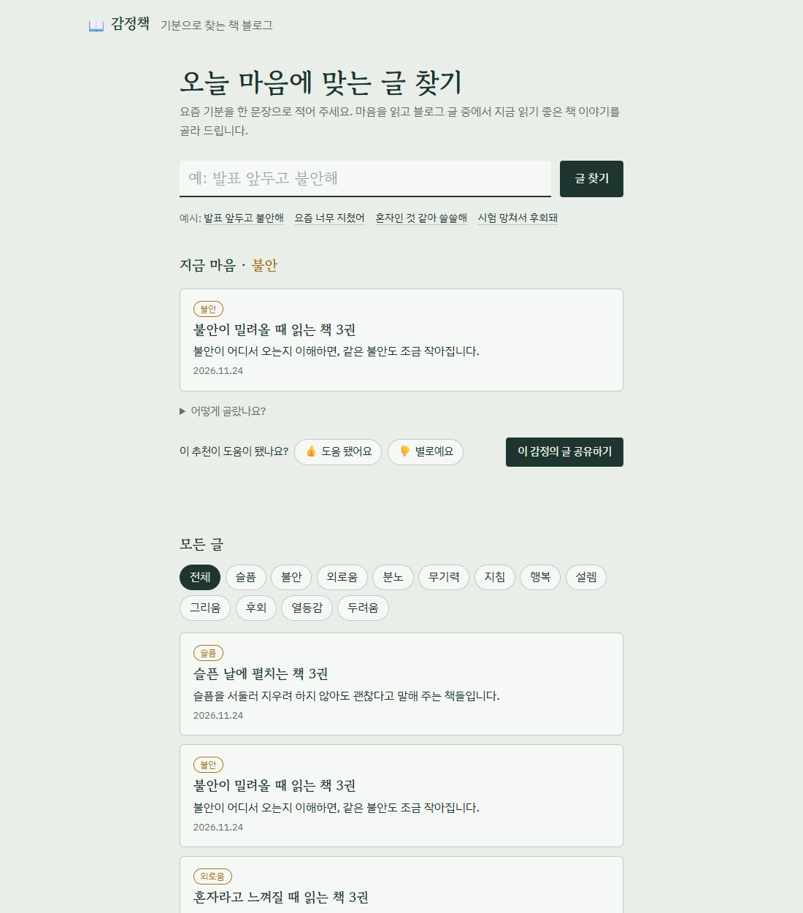
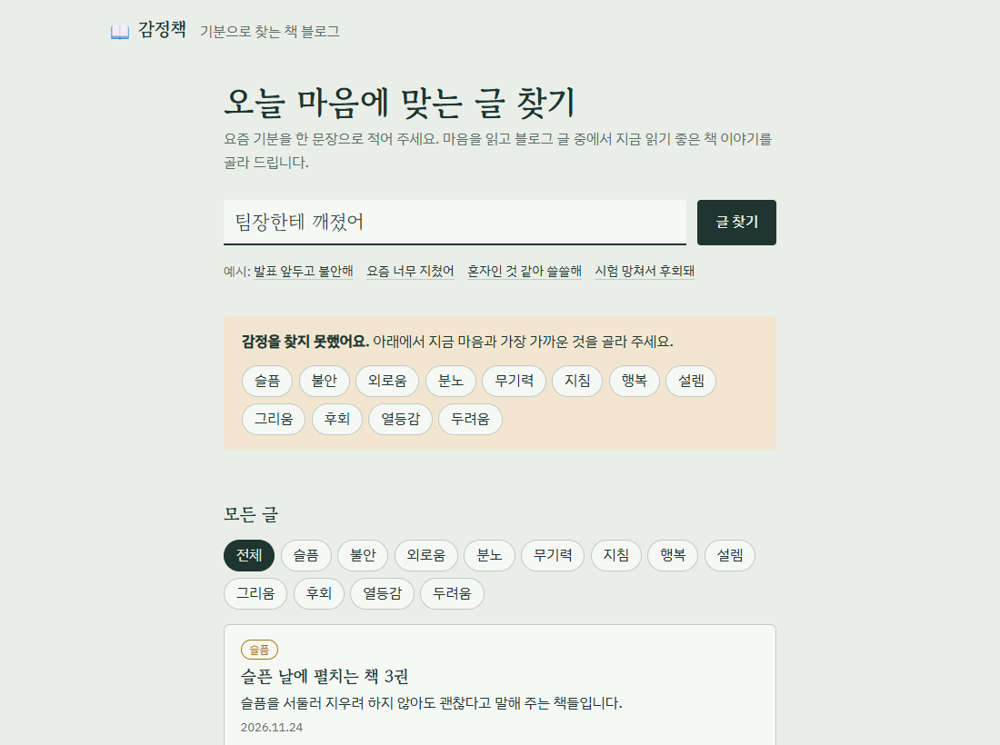
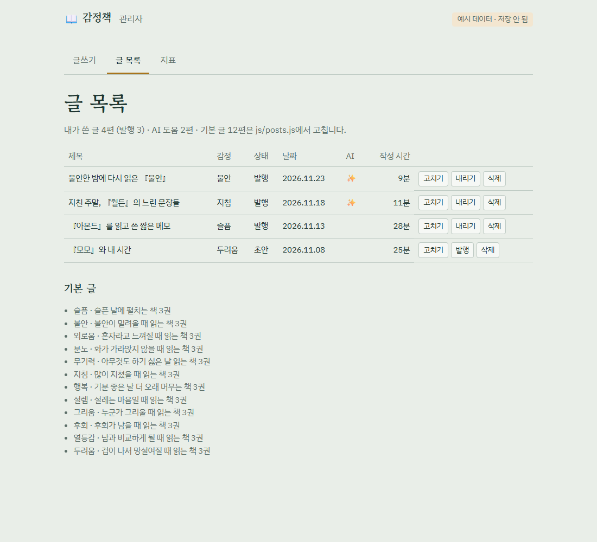
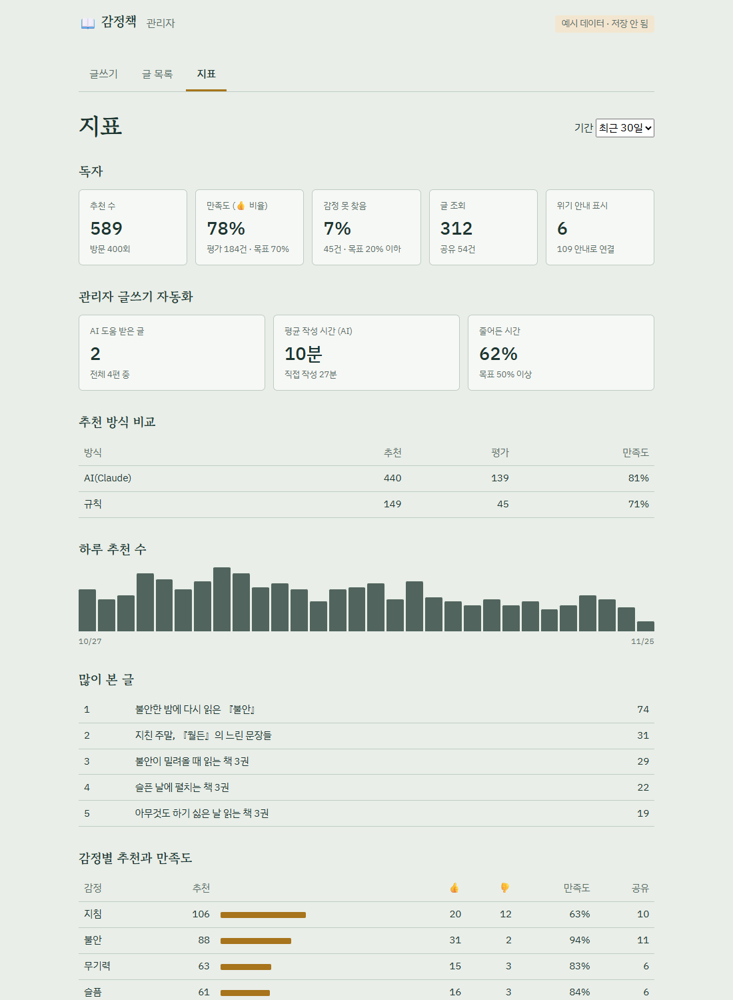

# TEST REPORT · 감정책 블로그 (v2.1)

| 항목 | 내용 |
|---|---|
| 테스트 일자 / 대상 | 2026-11-25 / v2.0 블로그 (방문자 `index.html`, 관리자 `admin.html`, `js/`, `firestore.rules`) |
| 환경 | Windows 11, Chrome (헤드리스 자동 테스트 + 실제 배포 사이트 확인) |
| 결과 | **단위 테스트 55/55 통과 · 화면 테스트 20/20 통과 · 보안 규칙 6/6 통과** · 알려진 한계 3건 |

| 버전 | 날짜 | 변경 |
|---|---|---|
| v1.0 | 11-24 | 감정 추천 서비스: 로직 35개, 화면 10개 |
| v2.0 | 11-25 | 블로그 + AI: 로직 55개, 화면 20개 (가짜 AI 서버 포함) |
| v2.1 | 11-25 | 2쪽 압축, 유저플로우 스크린샷 추가, 배포 사이트 보안 규칙 결과 추가 |

## 1. 전체 유저플로우 (화면)

**방문자:** 첫 화면 → 문장 입력 → 추천 → 글 보기 / 예외: 감정 못 찾음, 위기

| ① 첫 화면 (글 찾기 + 모든 글) | ② 추천 결과 | ③ 글 보기 |
|---|---|---|
|  |  |  |
| **④ 감정 못 찾음 → 직접 선택** | **⑤ 위기 표현 → 109 안내** | **⑥ 모바일 375px** |
|  |  |  |

**관리자:** 로그인 → 글쓰기(AI 채우기) → 발행 → 글 목록 → 지표 (⑦~⑨는 예시 모드 `?demo=1` 화면)

| ⑦ 글쓰기: 메모 → 도우미가 칸 채움 | ⑧ 글 목록 | ⑨ 지표 (글쓰기 자동화 포함) |
|---|---|---|
|  |  |  |

> ④ ⑤ ⑦은 AI 연결 전이라 **규칙 방식**으로 동작한 화면입니다. Claude 연결 후 같은 흐름을 AI 결과 화면으로 바꿔 v2.2로 갱신합니다.

## 2. 기능별 단위·화면 테스트

실행: `tests/run.html` (단위), `tests/ui.html` (화면을 실제로 조작) → 브라우저로 열면 결과가 바로 나옵니다.

| 기능 (PRD) | 테스트 ID | 확인 내용 | 결과 |
|---|---|---|---|
| 데이터 | D1~D6 | 감정 12개, 책 3권씩, 단어 중복 없음, 기본 글 12편 | ✅ 6/6 |
| 감정 인식 (F2 규칙) | R1~R22 | 대표 문장, 띄어쓰기, 과거형, 관용 표현("죽을 만큼 행복해") | ✅ 22/22 |
| 위기 안내 (F3) | C1~C4, U9 | 띄어쓰기·다른 감정과 섞여도 109 안내, 추천 카드 없음 | ✅ 5/5 |
| 글 고르기 (F2) | P1~P2 | 같은 감정 글만, 새 글 우선, AI에 보내는 데이터는 id·제목·감정·요약뿐 | ✅ 2/2 |
| AI 답 검증 (F2·F6) | A1~A6 | 없는 글·중복 제거, 최대 3개, 잘못된 답은 규칙으로, 도우미 답 길이·태그 정리 | ✅ 6/6 |
| AI 호출 (F2·F6) | AI1~AI4 | 가짜 서버로: "팀장한테 깨졌어" → 분노 추천, 서버 오류 → 규칙, 관리자 요청에 토큰 첨부 | ✅ 4/4 |
| 화면 도구 | T1~T2 | 조사(을/를, 으로/로), 이스케이프 | ✅ 2/2 |
| 지표 (F8) | S1~S9 | 기간, 방문 수, 감정·경로·**방식별**, 많이 본 글, **AI vs 직접 작성 시간** | ✅ 9/9 |
| 방문자 화면 (F1·F4) | U1~U8, U10~U13 | 목록 12편, 필터, 추천, 👍 잠금, 직접 선택, 빈 입력, **XSS 차단**, 글 보기·돌아오기 | ✅ 12/12 |
| 관리자 화면 (F6~F8) | M1~M7 | 예시 모드, 빈 칸 안내, 도우미 7칸 채움, 발행·작성 시간, **필수 칸 없으면 발행 막음**, 목록, 지표 | ✅ 7/7 |

**보안 규칙 (배포 사이트에서 로그인 없이 실제 요청):** 기록 추가 ✅ 허용 · 발행 글 읽기 ✅ 허용 · 기록 읽기 ✅ 거부 · 잘못된 기록(`type: "hack"`) ✅ 거부 · 글 쓰기 ✅ 거부 · 초안 포함 전체 글 읽기 ✅ 거부

## 3. 발견한 버그와 수정

| 버그 | 원인 | 수정 |
|---|---|---|
| 예시 "요즘 너무 지쳤어"가 감정 못 찾음 | 사전에 과거형 없음 | 과거형 9개 추가, R17~R22 (D-006) |
| Firebase 연결 후 첫 화면이 안 뜸 | Firestore 응답을 기다림 | 기본 글을 먼저 그리고 발행 글은 나중에 덧붙임, 8초 제한 |
| 로그인 전에 관리자 탭이 보임 | `display:flex`가 `hidden`을 덮어씀 | `[hidden]{display:none !important}` |
| 글쓰기 라벨 설명이 줄바꿈됨 | grid 라벨 안 글자와 span 분리 | 라벨 글자를 span으로 묶음 |

## 4. 알려진 한계와 아직 검증하지 못한 것

| 항목 | 현재 | 확인 계획 |
|---|---|---|
| K1~K3 규칙 한계 ("이제 불안하지 않아", "팀장한테 깨졌어", "엄마한테 미안해") | 규칙은 못 읽음 → 감정 직접 선택으로 이어짐 | **Claude 연결 후 실제 AI 결과 기록** |
| Claude 실제 호출 (Worker) | 미배포 | 배포 후: K1~K3, 도우미 3회, 다른 사이트 403, 비로그인 `/assist` 401, 1분 11회 429 |
| 관리자 로그인 → 실제 발행 | 로그인 화면 표시까지 확인 | 관리자 계정으로 글 1편 발행 → 방문자 목록에 표시 |
| 작성 시간 50% 단축 (H1) | 측정 전 | 리뷰 6편 (AI 3 / 직접 3) |
| 휴대폰 공유 창, Safari·Firefox | Chrome만 | 베타 기간에 확인 |
