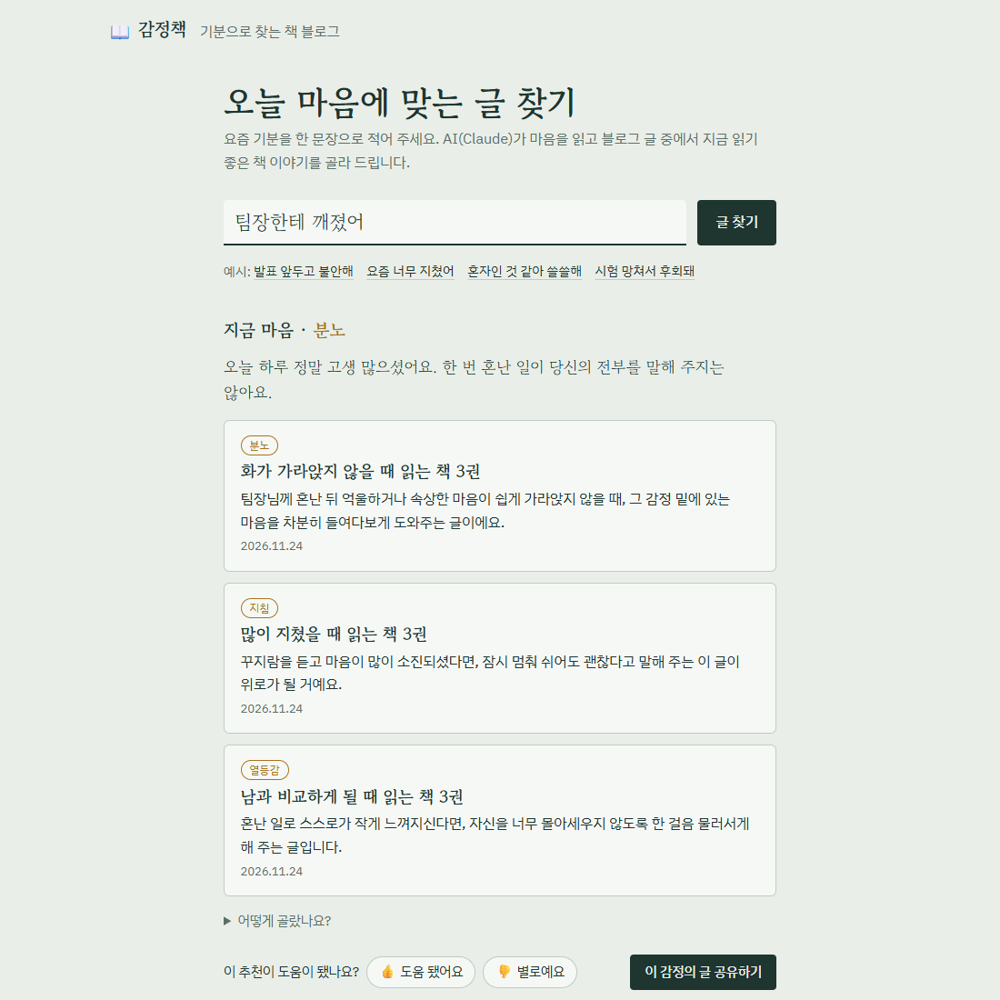
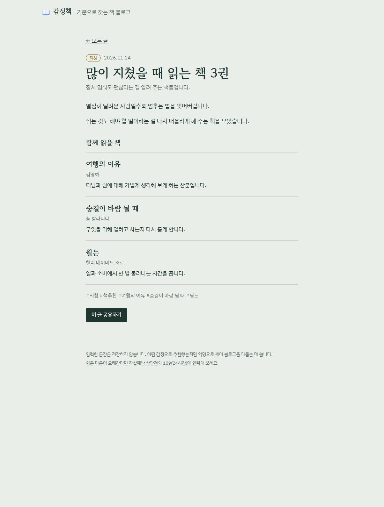
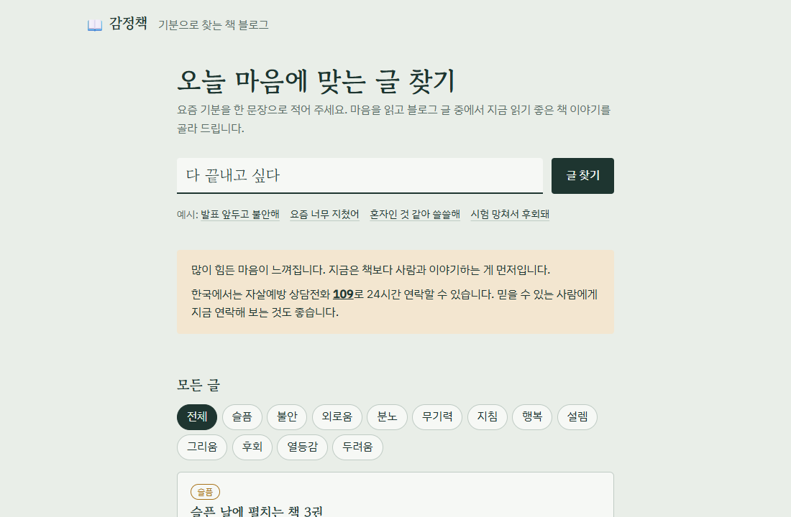
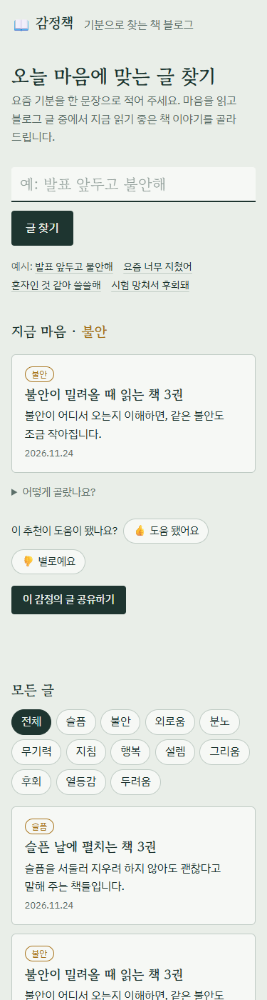
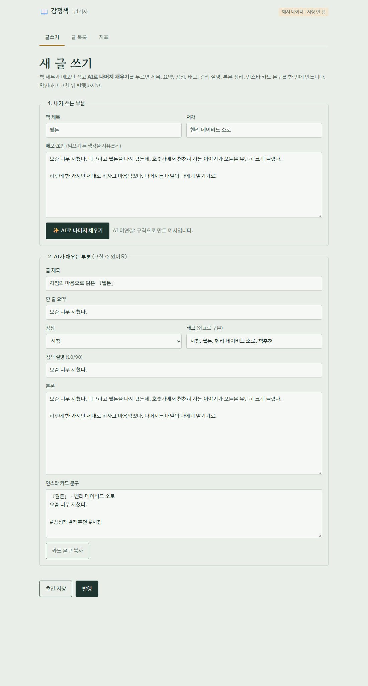
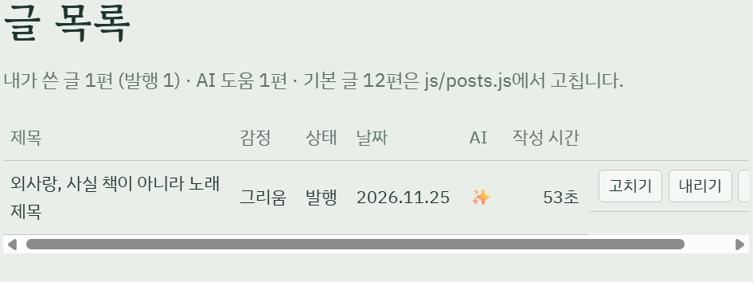

# TEST REPORT · 감정책 블로그 (v2.4)

| 항목 | 내용 |
|---|---|
| 테스트 일자 / 대상 | 2026-11-25 / v2.0 블로그 (방문자 `index.html`, 관리자 `admin.html`, `js/`, 중계 서버 `server/`, `firestore.rules`) |
| 환경 | Windows 11, Chrome (헤드리스 자동 테스트 + 실제 배포 사이트 확인) |
| 결과 | **단위 55/55 · 화면 20/20 · 중계 서버 13/13 · 보안 규칙 6/6 · 실제 Claude 3/3 · 관리자 실사용 1/1 통과** · 규칙 방식 한계 3건은 AI가 해결 |

| 버전 | 날짜 | 변경 |
|---|---|---|
| v1.0 | 11-24 | 감정 추천 서비스: 로직 35개, 화면 10개 |
| v2.0 | 11-25 | 블로그 + AI: 로직 55개, 화면 20개 (가짜 AI 서버 포함) |
| v2.1 | 11-25 | 2쪽 압축, 유저플로우 스크린샷 추가, 배포 사이트 보안 규칙 결과 추가 |
| v2.2 | 11-25 | AI 중계 서버를 Vercel로 옮기고 서버 테스트 13개 추가 (`tests/server.html`) |
| v2.3 | 11-25 | Claude 실제 연결 (Vercel), K1~K3 실제 AI 결과와 AI 추천 화면 추가 |
| v2.4 | 11-25 | 관리자 실제 흐름 확인 (로그인 → AI 도우미 → 발행 → 블로그 표시), 글 목록 버튼 잘림 수정 |

## 1. 전체 유저플로우 (화면)

**방문자:** 첫 화면 → 문장 입력 → 추천 → 글 보기 / 예외: 감정 못 찾음, 위기

| ① 첫 화면 (글 찾기 + 모든 글) | ② **AI 추천** ("팀장한테 깨졌어") | ③ 글 보기 |
|---|---|---|
|  |  |  |
| **④ 감정 못 찾음 → 직접 선택** | **⑤ 위기 표현 → 109 안내** | **⑥ 모바일 375px** |
|  |  |  |

**관리자:** 로그인 → 글쓰기(AI 채우기) → 발행 → 글 목록 → 지표 (⑦ ⑨는 예시 모드 화면, ⑧은 **실제 관리자 화면**)

| ⑦ 글쓰기: 메모 → 도우미가 칸 채움 | ⑧ **실제 발행 후 글 목록** (AI ✨, 작성 53초) | ⑨ 지표 (글쓰기 자동화 포함) |
|---|---|---|
|  |  |  |

> ②는 실제 Claude 결과입니다. ④는 AI가 실패했을 때의 대체 경로(규칙 방식), ⑤는 AI를 부르기 전에 규칙으로 막는 화면입니다. ⑦은 예시 모드라 규칙 도우미가 채운 화면이며, 실제 AI 도우미 화면은 관리자 로그인 후 추가합니다.

## 2. 기능별 단위·화면 테스트

실행: `tests/run.html` (단위), `tests/ui.html` (화면을 실제로 조작), `tests/server.html` (중계 서버, Claude는 가짜로 대신) → 브라우저로 열면 결과가 바로 나옵니다.

| 기능 (PRD) | 테스트 ID | 확인 내용 | 결과 |
|---|---|---|---|
| 데이터 | D1~D6 | 감정 12개, 책 3권씩, 단어 중복 없음, 기본 글 12편 | ✅ 6/6 |
| 감정 인식 (F2 규칙) | R1~R22 | 대표 문장, 띄어쓰기, 과거형, 관용 표현("죽을 만큼 행복해") | ✅ 22/22 |
| 위기 안내 (F3) | C1~C4, U9 | 띄어쓰기·다른 감정과 섞여도 109 안내, 추천 카드 없음 | ✅ 5/5 |
| 글 고르기 (F2) | P1~P2 | 같은 감정 글만, 새 글 우선, AI에 보내는 데이터는 id·제목·감정·요약뿐 | ✅ 2/2 |
| AI 답 검증 (F2·F6) | A1~A6 | 없는 글·중복 제거, 최대 3개, 잘못된 답은 규칙으로, 도우미 답 길이·태그 정리 | ✅ 6/6 |
| AI 호출 (F2·F6) | AI1~AI4 | 가짜 서버로: "팀장한테 깨졌어" → 분노 추천, 서버 오류 → 규칙, 관리자 요청에 토큰 첨부 | ✅ 4/4 |
| 화면 도구 | T1~T2 | 조사(을/를, 으로/로), 이스케이프 | ✅ 2/2 |
| 지표 (F8) | S1~S9 | 기간, 방문 수, 감정·경로·**방식별**, 많이 본 글, **AI vs 직접 작성 시간** | ✅ 9/9 |
| 방문자 화면 (F1·F4) | U1~U8, U10~U13 | 목록 12편, 필터, 추천, 👍 잠금, 직접 선택, 빈 입력, **XSS 차단**, 글 보기·돌아오기 | ✅ 12/12 |
| 관리자 화면 (F6~F8) | M1~M7 | 예시 모드, 빈 칸 안내, 도우미 7칸 채움, 발행·작성 시간, **필수 칸 없으면 발행 막음**, 목록, 지표 | ✅ 7/7 |
| AI 중계 서버 (F2·F3·F6) | V1~V13 | 블로그 주소만 허용(다른 사이트 403), 위기 문장은 Claude 호출 없이 crisis, 없는 글 id 제거, IP당 1분 10회, 관리자 토큰 없으면 401·관리자 아니면 403, 키 오류 안내 | ✅ 13/13 |

**보안 규칙 (배포 사이트에서 로그인 없이 실제 요청):** 기록 추가 ✅ 허용 · 발행 글 읽기 ✅ 허용 · 기록 읽기 ✅ 거부 · 잘못된 기록(`type: "hack"`) ✅ 거부 · 글 쓰기 ✅ 거부 · 초안 포함 전체 글 읽기 ✅ 거부

**실제 Claude 결과 (배포된 블로그에서, 2026-11-25):** 규칙 방식이 못 읽던 문장 3개를 모두 읽었습니다.

| 문장 | 규칙 방식 | Claude | 추천한 첫 글 |
|---|---|---|---|
| 팀장한테 깨졌어 | 감정 못 찾음 | **분노** | 화가 가라앉지 않을 때 읽는 책 3권 |
| 이제 불안하지 않아 | 불안 (잘못 읽음) | **행복** | 기분 좋은 날 더 오래 머무는 책 3권 |
| 시험 망쳐서 엄마한테 미안해 | 감정 못 찾음 | **후회** | 후회가 남을 때 읽는 책 3권 |

배포 서버 직접 확인: 사전 요청 204 · 다른 사이트 403 · 비로그인 `/api/assist` 401

## 3. 발견한 버그와 수정

| 버그 | 원인 | 수정 |
|---|---|---|
| 예시 "요즘 너무 지쳤어"가 감정 못 찾음 | 사전에 과거형 없음 | 과거형 9개 추가, R17~R22 (D-006) |
| Firebase 연결 후 첫 화면이 안 뜸 | Firestore 응답을 기다림 | 기본 글을 먼저 그리고 발행 글은 나중에 덧붙임, 8초 제한 |
| 로그인 전에 관리자 탭이 보임 | `display:flex`가 `hidden`을 덮어씀 | `[hidden]{display:none !important}` |
| 글쓰기 라벨 설명이 줄바꿈됨 | grid 라벨 안 글자와 span 분리 | 라벨 글자를 span으로 묶음 |
| 글 목록에서 [삭제] 버튼이 잘림 | 표가 좁은 화면에서 옆으로 넘침 | 버튼 칸이 줄바꿈되도록 수정 |

## 4. 알려진 한계와 아직 검증하지 못한 것

| 항목 | 현재 | 확인 계획 |
|---|---|---|
| AI 응답 시간 | 약 5초 (독자 추천) | 10초 목표 안. 20초 넘으면 규칙 방식으로 대신 |
| 관리자 AI 도우미 | ✅ 실제 확인: 로그인 → AI 채우기 → 발행(작성 53초) → 방문자 블로그 맨 위에 표시 | 도우미 2회 더 실행해 결과 품질 기록 |

| 작성 시간 50% 단축 (H1) | AI 글 1편 53초 (직접 작성 비교 전) | 리뷰 6편 (AI 3 / 직접 3) |
| 휴대폰 공유 창, Safari·Firefox | Chrome만 | 베타 기간에 확인 |
